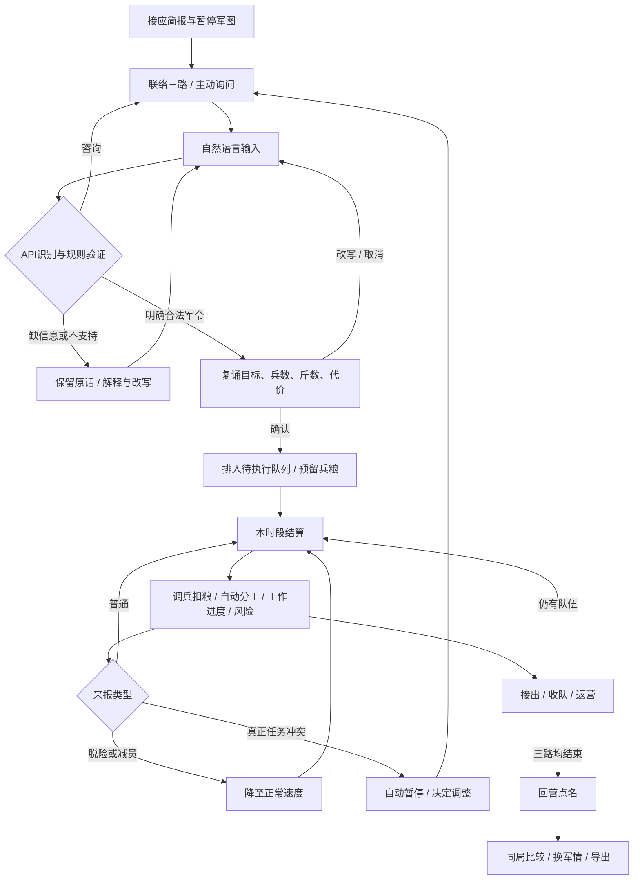

# 本关难度与完整链路审计

研究日期：2026-11-15。对象为独立试玩 `yiling-radio-lab`，端口8950，规则v1 / 美术v2，存档外层version=3、数值世界version=1。核对当前源文件与运行服务，未改游戏。正式第4章、旧版8949和8948不在本次修改范围。以下区分现有机制与设计评价，不视为用户审核通过。

## 1. 当前难度设定

目前只有一套难度，没有简单/普通/困难选择。目标文字是带回将领与部众；系统结算分开统计4名将领、3路已知批次、接应兵减员、营中余粮，没有单独的胜利/失败布尔值或结算评分。4/4将领脱险不自动等于3/3批次接齐。

| 约束 | 当前真实数值和后果 |
|---|---|
| 兵力 | 总计2500名接应兵，预备兵、前线兵、返营兵与减员守恒。原部协作的固定工作量不计入这2500名可调兵 |
| 粮草 | 总计5000斤；出动新增士兵每人携1斤，由营粮转入队伍粮袋 |
| 持续消耗 | 在外每人每时段0.5斤，每队向上取整；即使坚守/重整仍需吃粮。营内与回程不另计前线粮 |
| 补给 | 接应队额外口粮、饥饿散兵救济分别记账；回营余粮归还营粮，无路程与运输损耗模拟 |
| 缺粮 | 当期进展乘0.5，受挫概率加25个百分点；不是立即全军失效，既有工作不会清零 |
| 撤离窗口 | 傅肜第6、旧营第7、沙摩柯第8时段末关闭；同一末时段完成仍算完成 |
| 风险 | 掩护达到需求为0%；达到60%但不足需求为25%；有掩护但不足60%为50%；无掩护为100%。其他惩罚叠加后封顶100% |
| 损失 | 每路线、每时段固定随机抽样；当随机落入风险区间，25%风险通常损失25人，更高风险损失50人。紧急撤回另有50%概率、最多50人减员 |
| 返营 | 正常完成后下一时段返营；该次结算中不能在另一条路同时工作，结算后下一次下令可调用 |
| 结束 | 三路都收队并完成返营即结算；没接出的批次可失联，接应队仍能结束并重试，不会无限等待 |

“斤”是本试玩的易读单位，不据此宣称历史口粮比例或真实行军耗粮。当前军粮是前线调拨账，并未模拟军营所有人的每日口粮。

## 2. 三路自动执行的差异

| 路线 | 工作链与自动分工 | 实际决策作用 |
|---|---|---|
| 傅肜 | 换防500 → 隘口准备500 → 队尾过隘500。少于1000名接应兵借本部在中间阶段整队；达到1000可分500人同步准备隘口 | 早投入更多兵有机会缩短链路，但不是人数线性换时间；要兼顾后阵与退路 |
| 冯习、张南 | 迁旗500与清路500都完成后，护送1000。达到1000人可并行迁旗清路；原军吏每时段贡献250迁旗工作；撤军阶段最多300人守岔口，剩余护送 | 张南达到护送一半先脱险，冯习后出；部分成功和接齐不同。兵太少会被留守占去较大比例 |
| 沙摩柯 | 东沟搜寻500、西沟1000，原部每时段250搜寻工作；已找到的一批在下一时段才能过林口。守口需求随时段300→500→700 | 较晚开始或较慢搜寻会让守口占用上升，出现人还在、能搜的人变少的压力 |

玩家决定人数、接应目标、补粮与主要行动，不再决定军吏、清路、分流等微观人数。旧引擎中的专项物资包已关闭，不能用粮购买绳索、担架、医疗或消除敌军。

## 3. 临场变化的真实范围

每局至多一次任务冲突。默认种子731115是旧营饥饿散兵；换军情只把初始种子加1。种子%3选事件路线，事件在该路首次开始执行、仍活动时生成，不是连续的随机事件牌堆。

| 军情 | 额外任务 | 可用反应 |
|---|---|---|
| 731115 / %3=0 | 旧营新增饥饿散兵 | 增援400人或救济400斤足额解决；现队重整1时段也能解决；照旧则持续50%效率 |
| 731116 / %3=1 | 傅肜侧翼追兵，新掩护点 | 增援400人或现队重整1时段；粮不能解决敌军。照旧50%效率并额外25个百分点风险 |
| 731117 / %3=2 | 西沟新增饥饿部众 | 增援400人、救济500斤或现队重整1时段；照旧50%效率 |

少量增援或救济按比例缓解。增援与救济取较大的解决比例，不相加凑满；例：200人加200斤旧营救济仍只是50%解决比例。已确认对该路的回令会解除阻塞提示，但不一定解除冲突本体，明确继续是接受后果。回令后不会每时段重新强制询问。

## 4. 完整操作和执行链

一时段30秒，可暂停、正常、4倍，或手动推进至下次回报。输入框聚焦、API等待、复诵、详情、手记和札记期间暂缓，后台或刷新暂停。普通军报不要求发“继续”；任务冲突会阻止推进直到明确决断。首条命令前手动空等有一次确认；自动推进与手动推进共用同一个结算入口。

API只给意图和说法，规则引擎决定实际人数、扣粮、工作量与结局。询问不出兵；草案不执行；确认后也要结算才执行。取消、改原话、换对象、重开使旧请求失效。回话格式或证据不合格自动再纠正一次，仍失败则拒绝。询问和送粮等失败时会保留输入，但当前部分错误仍把技术字段直接显示给玩家。

## 5. 数值对照：预备兵和粮是否有效

以下为规则层的可重复对照，不是代理盲玩成功率。开局固定傅肜500、旧营800、山林700，留500名预备兵；每期精确补足当期口粮，其余不变。含正常返营时间。三种军情共11个合法反应均得到4/4将、3/3批次；下表列默认军情。

| 默认旧营冲突反应 | 全部返营用时 | 减员 | 余粮 |
|---|---:|---:|---:|
| 照旧，接受减速 | 7时段 | 0 | 450斤 |
| 增援400人 | 5时段 | 0 | 650斤 |
| 现队重整1时段 | 6时段 | 0 | 850斤 |
| 救济400斤 | 5时段 | 0 | 850斤 |

差异是真实的：增兵虽然每期多吃粮，但更快收队可能反而省总粮；花粮救济也可能通过缩短在外时间回本。因此不能只比较单次标价。默认情形中救济的结果优于重整（同余粮且快1时段），也比增援多剩200斤；这是一处局部优势选项。另两种军情下不保持这个排序：后阵重整5时段、余1000斤，增援同5时段、余850斤；山林增援5时段、余1200斤，救济同5时段、余750斤。

若同样开局完全不再补粮，只对请示接受照旧：最终3/4将、2/3批次、减员50人，营中却还有3000斤未被调去。说明送粮确实影响结果，营中有粮不能代替送到队伍。若完全不下令空等，三路都失联并正常结束，不形成死循环。

设计评价：这是有资源后果的调度关，但当前更偏宽容入门难度。精确补给时不调整冲突也常能接齐；预备兵有效，但不是救齐的必要条件。每局只有一个冲突、补粮无运输时延或容量约束，后段容易变成根据口粮报告重复补数。结束时间、损失与余粮目前是展示统计，尚未形成清楚的等级目标，因此“更好地赢”的动力也偏弱。

## 6. 审计已确认的链路缺口

1. **同一时段后续补粮可覆盖已确认的重整。** 同路只有一个队列项，后一次确认整项覆盖。补粮按已执行mission还原行动，而非保留待执行的reorganize。请示提示却已解除，导致玩家以为会先重整，实际仍承受50%效率，也不再请示。规则层最小复现已保存，且代理实玩独立遇到对应问题。
2. **尚未执行的军令预留额度与咨询口径不一致。** 已排定2000人、2000斤后，资源栏显示剩500人、3000斤；overview回话仍说可调2500人、5000斤，并可能用未来阶段描述还没执行的任务。真实库存与可用额度应分开。当前超额验证会阻止实际超支，但玩家依据会错误。
3. **建议型询问缺少稳妥回答通道。** 最终三组中，Terra与GPT-6.1 Sol独立问“需要多少兵粮”被比较引文校验拒绝，GPT-6 Sol问类似问题则只得到0兵0粮的现状模板。这类咨询本来就可能没有玩家给出的数字，不能要求玩家先知道候选数量才允许询问需求；安全地没有执行，也不等于回答了问题。
4. **“带X斤”与“另补X斤”语义混用。** 新兵自动携粮是固定成本，而自然语言中的总携粮可能被当成额外粮，复诵与原意存在落差。确认页显示了实际总成本，并非未经确认重复扣账；问题是把玩家想表达的总携粮改成了额外补粮。应做明确换算或澄清。
5. **初始信息不足、面板遮挡。** 详情主要给现有人数、现有粮和截止时段；在0兵时很难估算该派多少，路线初报里的换防、迁旗清路、两沟守口知识也未完整通过现状问答提供。这些知识并非从数据中删除：初始点击“重说一遍”在该路尚无历史来报时会回退到原始路线说明，但主查询入口没有自然带出。详情浮层在1440×900可覆盖推进按钮，收起后能继续。
6. **本时段缺粮惩罚被简报截掉。** GPT-6 Sol的第4、5时段旧营原始记录明确写出“口粮不足，接应进展减半、受挫概率增加25个百分点”，可见简报却只预警下一时段缺粮。`shortReport`从“本轮用粮”处截断时删掉了后面的当期后果。缺粮确实生效，玩家却不容易知道本次已经受影响。主代理已用这两段实际记录复现截断，详见定点证据。

因此“从开局到任意结果存在闭环”可以确认，“自然语言与连续改令的所有常见链路完整”不能确认，已有明确反例。下一步应先处理语义与队列保留，再据更可靠的玩家反馈调整难度，不应先通过加大减员或缩短期限来弥补。

## 7. 证据与边界

本次重新运行23项规则/语义/表现/服务检查全部通过，另跑25组旧数值对照和11组严格合法反应对照；通过的是这些断言，不等于盲玩或全部语言样本通过。代理测试使用真实UI与API，处于隔离上下文；模型玩家并非真实用户样本。数值对照中的补给是规则层精确控制，不能当作新玩家自然会做出的动作。

源入口：`src/core.ts`（工作量/耗粮/风险/归营）、`src/engine.ts`（自动政策/冲突/预算/确认/预测）、`src/app.ts`（计时/输入/API/复诵/来报/结算）、`src/presentation.ts`（位置与现状报告）、`ai.mjs`（语义及真实数值回话）。测试前源哈希存 `checks/agents/baseline.json`，本次数值证据为 `checks/agents/numeric-audit.json`，定点复现为 `checks/agents/targeted-reproductions.json`。

本地研究扫描器未识别此定制Web原型，返回的低置信度native猜测未采用；本报告以真实package、TypeScript源码、浏览器与8950服务身份为准，不据扫描建议做注入或逆向。
