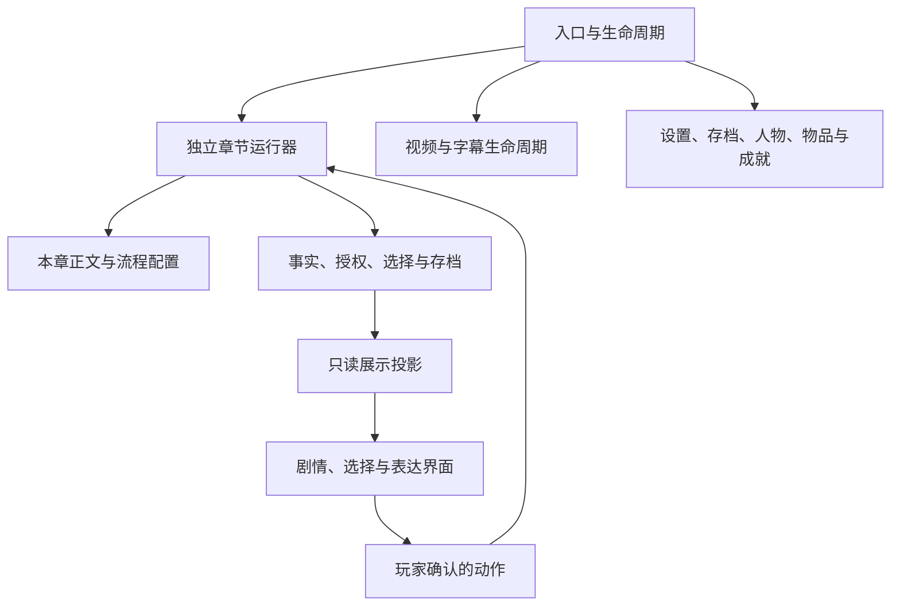

# 架构与扩章边界

2026-11-17：第一轮剧情与选择架构调整已实现，待用户试玩审核。范围、参考依据、备份与验证记录见 [本轮记录](ITERATION-20261117.md)。线索操作界面、思绪画布及手机系统已退役，不以旧画布文档恢复入口。

## 当前职责

| 层 | 入口及职责 |
| --- | --- |
| 装配 | `game.ts` 与各章入口管理服务、生命周期、页面及玩家动作，不让跨章共享层依赖章节实现 |
| 章节状态 | `chapters/chapter-one/session.ts` 等独立运行器维护各章事实、流程、授权和结局 |
| 选择契约 | `narrative/presentation.ts` 定义只读选择数据和可执行动作查询 |
| 第一章投影 | `chapters/chapter-one/narrative-decision.ts` 从实际调查生成选择，不授予应允或成功 |
| 界面 | `game/narrative-choice.ts` 展示选择；`views/story.ts` 与第二、第三章视图展示单栏表达；确认后交回章节执行 |
| 输入保护 | `game/composition-guard.ts` 延后中文输入法组词期间的异步重绘；与线索系统无依赖 |
| 通用组件 | 设置、存档、视频、人物、剧情物品及成就继续复用，手机购物及相关接口已删除 |
| 兼容 | 旧事实、图关系、聊天、钱包等结构继续读取；旧手机偏好映射为普通 AI，旧结局可查看 |

第二轮已将第二、第三、第五章复命、第七章的剧情选择接入共同投影、展示和当前节点校验，见 [第二轮记录](ITERATION-20261117-02.md)。这是渐进式调整，各章仍有独立入口与状态机，尚未全部改成通用时间线引擎。第一章原有事实推导核心和旧存档字段暂留为兼容数据，不提供旧画布操作界面。已知文件规模提示仍存在，不将本轮称为全架构重写。

## 剧情与状态边界

获得事实、形成判断、提出请求、对方应允、行动完成分别记录。删除推理面板不等于直接授予姜维应允；新剧情选择仍检查真实调查条件，并进入原来的通传对白。视频承担的内容不再重复播放成普通对白。AI 判定与回应沿用本地设计，本轮未调整提示词或判定标准。

第一章 `game.ts` 装配运行器、展示、播放器及存档。第二章 `chapter-two.ts`、第三章 `chapter-three.ts` 使用本章运行器。第四章接入 `demos/yiling-rescue`；第五章军报与第七章调查保持各自玩法。

`session/story-graph.ts` 只校验节点编号、入口、选项和跳转，不解释剧情。`session/save-recovery.ts` 提供原始字节备份、回读核验及受保护替换；备份失败或记录被其他窗口修改时，不覆盖原自动档。

## 添加章节

1. 将正文、流程和契约放在 `content/chapters/<chapter>/`，运行器与投影放在对应章节目录。
2. 在 `chapters/catalog.ts` 登记；具备实际运行器与验证记录后再标记可玩。
3. 使用独立存档键与 `chapterId + contentVersion`，显式处理旧档和开发试玩隔离。
4. 跨章只传定义清楚的进度，不传内部请求句柄或未确认授权。只读展示不能写状态。
5. 执行架构、类型、相关状态测试和浏览器验证；Cocos 编辑器及用户审核分别记录。

## 检查与资源

`npm run check` 检查架构和类型；`npm run build` 构建浏览器版本；`npm run test:game` 与 `npm run test:api` 运行当前单元测试。日常 `npm run verify:daily` 包含第一章完整浏览器流程。`node GameStarter/tests/narrative-ui.browser.mjs` 检查前三章桌面和横屏对话、退休入口及旧手机偏好。

架构守卫检查导入、章节交叉依赖与运行时循环，文件规模仅提示。首次完整运行需 `npm ci` 和 Git LFS 素材。测试使用受控模型响应，不能代替真实模型体验或用户审核。

字幕只在公共 `subtitles.css` 维护；发布按当前影片引用选择资源并检查哈希。保持 assets 的 `.meta` 与 UUID；不修改 Cocos 缓存。构建、缓存、输出报告与本机凭据不进入 Git。
