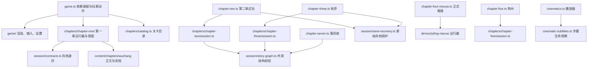

# 架构与扩章边界

2026-11-02 的设置复用、AI引导和验证分层见[AI配置与日常维护记录](AI-GUIDANCE-20261102.md)。日常检查使用 `verify:daily`；全分支与故障检查按改动或发布需要执行。

2026-11-02 的素材发布校验、视频清理和章节回归见[本轮检查记录](REVIEW-20261102.md)。

运行与代码架构说明。当前检查见[2026-10-29 review 与重构](REVIEW-20261029.md)，历史检查见[2026-10-23 架构 review](REVIEW-20261023.md)。

## 当前结构

第一章可完整游玩；第二章由 `chapter-two.ts` 和 `chapters/chapter-two/session.ts` 提供独立内容和存档。第三章街亭由 `chapter-three.ts` 装配，`chapters/chapter-three/` 管理三幕流程、最多五次连续进言、线索来源、兵力到营与结局，`persuasion.ts` 维护新增理由累计和人数上限。

| 模块 | 职责 |
| --- | --- |
| `chapters/chapter-one/session.ts` | 阶段、场景、段落、真实事件推进 |
| `session-state.ts` / `session-restore.ts` | 章节状态、旧档兼容、事实重建与恢复 |
| `flow-validation.ts` | 章节身份、重复编号、场景/路线/段落/影片引用验证 |
| `thought-actions.ts` / `thought-canvas-model.ts` / `thought-workspace.ts` | 本章证据、推理与思绪操作 |
| `expression-actions.ts` | 本章表达、请求取消、玩家确认与 NPC 回应编排 |
| `views/` | 本章场景、思绪与导航模板 |
| `game/` | 当前入口的 UI 编排部件；部分类型仍依赖第一章，不是已经泛化的全关卡框架 |
| `chapters/chapter-two/` | 第二章完整影片流程、两轮表达与独立存档 |
| `chapters/chapter-three/` | 街亭独立状态机、规则、语义判定、人物与手机适配、视图；素材与正文保留各自来源 |

旧 `chapter-session.ts` 等导入地址保留兼容导出。`expression-agent.ts` 与 `npc-dialogue.ts` 服务第一章语义。

## 添加章节

1. 在 `content/chapters/<chapter>/` 放独立内容，在 `src/chapters/<chapter>/` 放该章运行器、校验与视图。共享的通用行为才进入共享层。
2. 在 `chapters/catalog.ts` 登记状态；有实际运行器和验收后再由 `preview/planned` 改为 `playable`。
3. 使用独立存档键和 `chapterId + contentVersion`，建立显式加载入口。不能读写第一章内部状态或将预览记为已通关。
4. 跨章只传审核定义的玩家进度，不传章节内部的授权、证据、请求句柄。共享层不得反向依赖章节实现。
5. 执行架构、类型、玩法测试与浏览器验收；编辑器验收单独报告。

## 自动检查

`npm run check:architecture` 已接入根目录 `check` 和 `build`：

- 文件规模建议：代码 500 行、CSS/HTML 700 行、32,000 字符；超出只提示，不阻止构建。
- 扫描网页源码、Cocos 脚本、内容类型/示例、服务、工具和测试；检查 TypeScript 相对导入、运行时循环依赖、章节交叉依赖及当前/旧版反向依赖。
- 类型导入不算运行时循环；不通过允许名单豁免现存循环。
- 剧情 JSON、Markdown、历史视频脚本、设计源稿、缓存和历史源码快照不受代码行数门禁。它们保留原始编辑/审核结构，不属于当前编译入口。

检查是结构约束，不能证明剧情正确或取代浏览器试玩。结果写入本地忽略的 `outputs/architecture-20261023/architecture.json`。

## 文件与资源

旧版网页入口、专属界面及回归脚本已移除，旧 macOS 发布流程退出维护。当前游戏保留原存档键、CSS 加载顺序、素材路径和 Cocos `.meta`。共用的结局卡册、音频、视频播放器与底层类型继续使用。

UI 维护入口：[思绪画布定稿规范](../design/THOUGHT-CANVAS-FINAL.md)、[对白界面规范与修订](../design/DIALOGUE-INK-UI-20261023.md)、[思绪界面规范](../design/THOUGHT-NIGHT-UI-20261023.md)。历史修订不能覆盖文档中的现行要求。

## 2026-10-29 共享模块与发布约束

`session/story-graph.ts` 统一第二、第三、第七章的节点编号、入口、选项和跳转校验，只负责结构，不解释剧情条件。各章的证据、计分、行动和结局仍在各自运行器内。历史节点可以保留，不能仅凭当前不可达就删除旧存档所需编号。

`session/save-recovery.ts` 提供原始字节备份、回读核验及受保护的首次替换。第二章原导出地址保留为兼容转发，第三章对无法解析和不兼容的自动存档使用同一实现。备份失败或其他窗口已改写原记录时不覆盖自动档；仍可另存手动档。

`cinematic-subtitles.ts` 管理每次播放的字幕轨道及加载回调，随播放器释放。字幕可见性只在首帧实际显示后开启，播放错误时隐藏。静音状态由按钮表达，避免常驻文字覆盖字幕。

`tools/video/vtt.mjs` 只解析和规范化字幕文本；`subtitles.mjs` 检查影片、字幕与目录版本绑定。构建按当前引用复制字幕，`check:assets` 检查发布清单和哈希。源目录的历史 VTT 不进入发布，但保留原文件。

`test:game` 与 `test:api` 自动发现各自目录的 `.test.mjs`，新增测试无需再手工补长命令。完整技术验证为 `test:stability`；构建后执行 `test:stability:browser` 验证浏览器流程。真实模型、人工听审、Cocos 编辑器和安装包仍各自验收。
