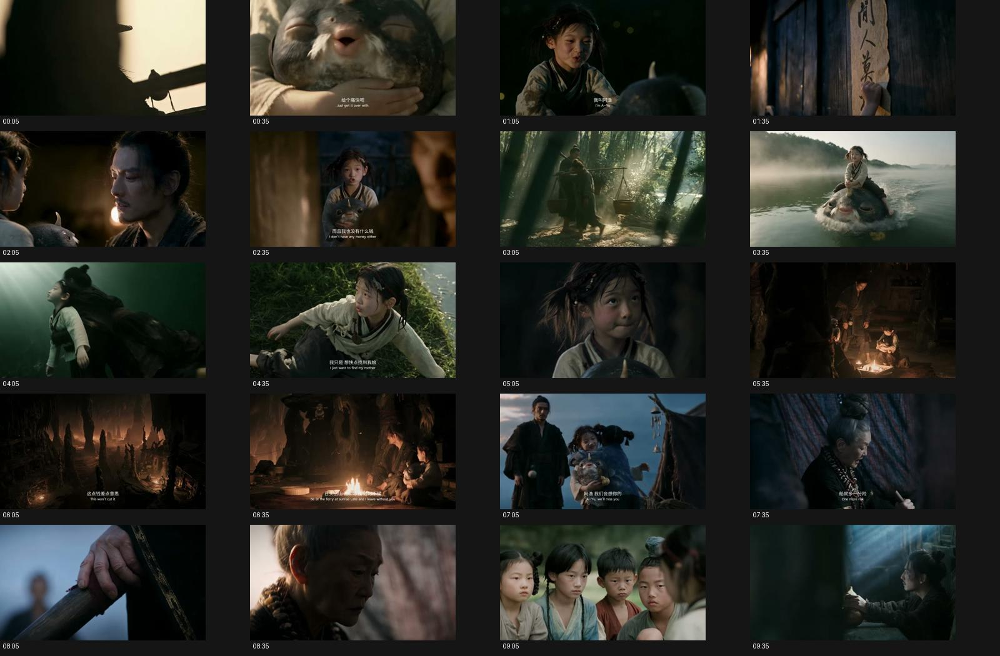
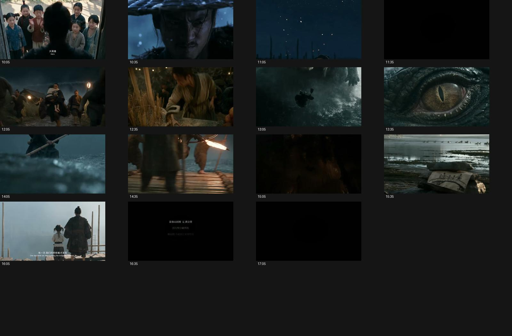
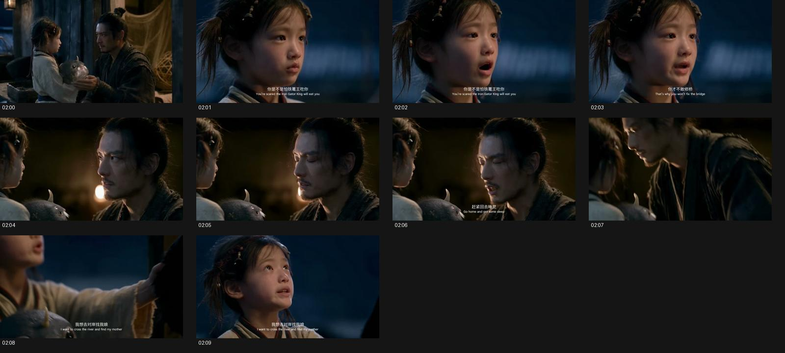
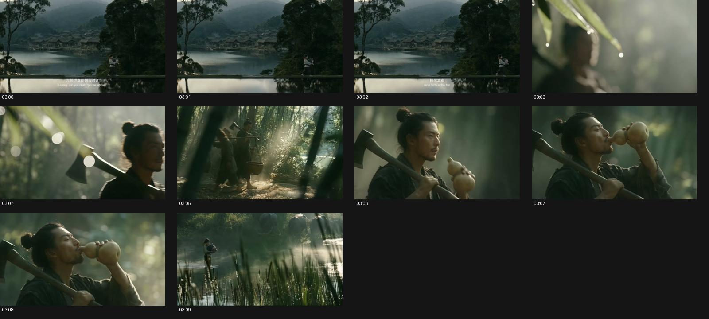
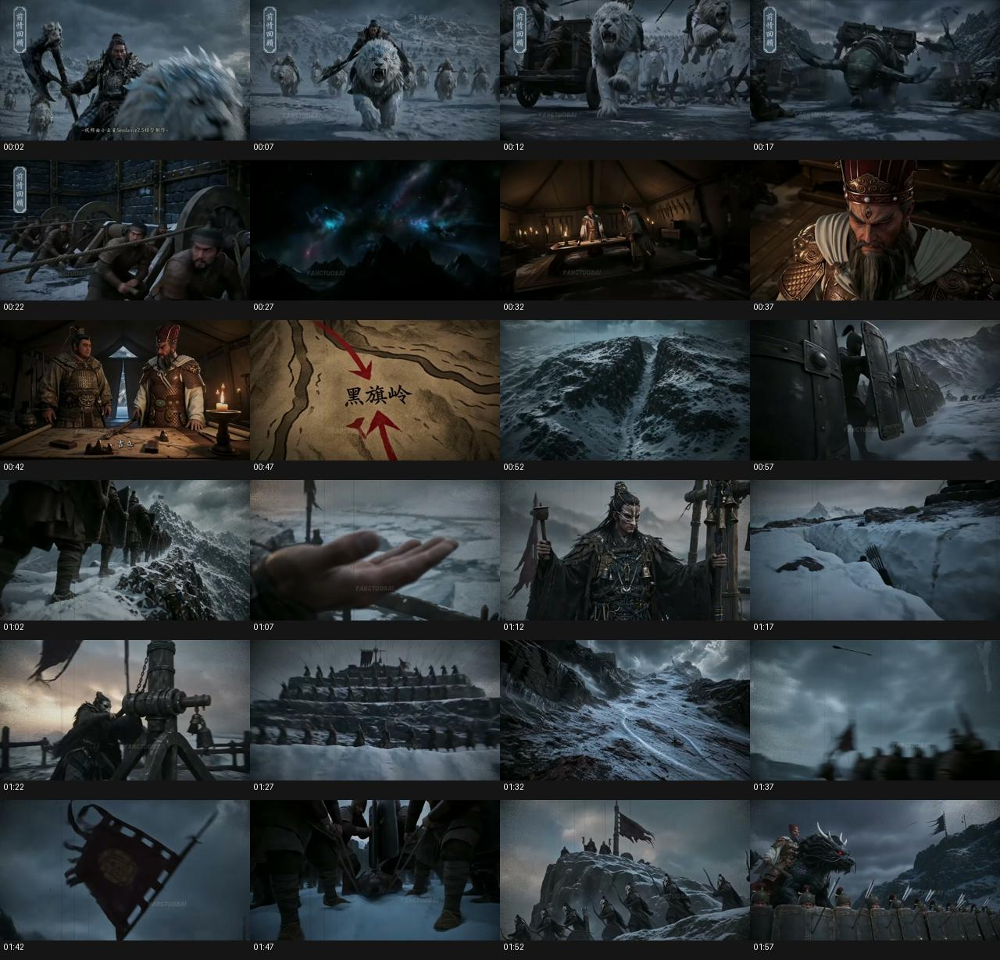
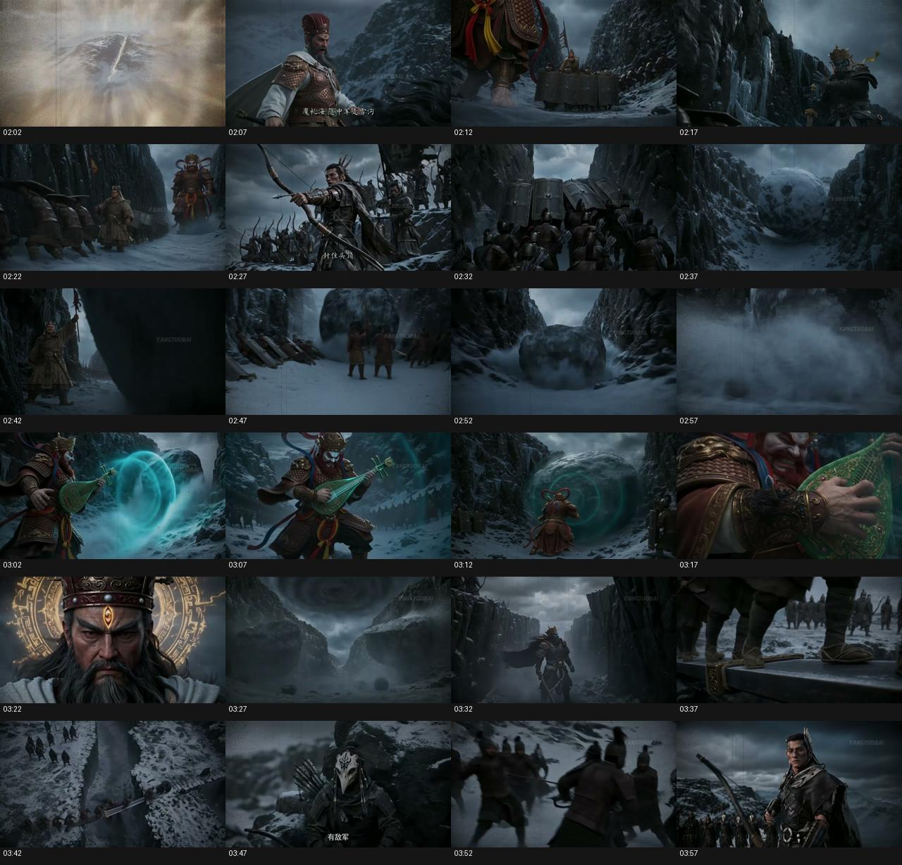
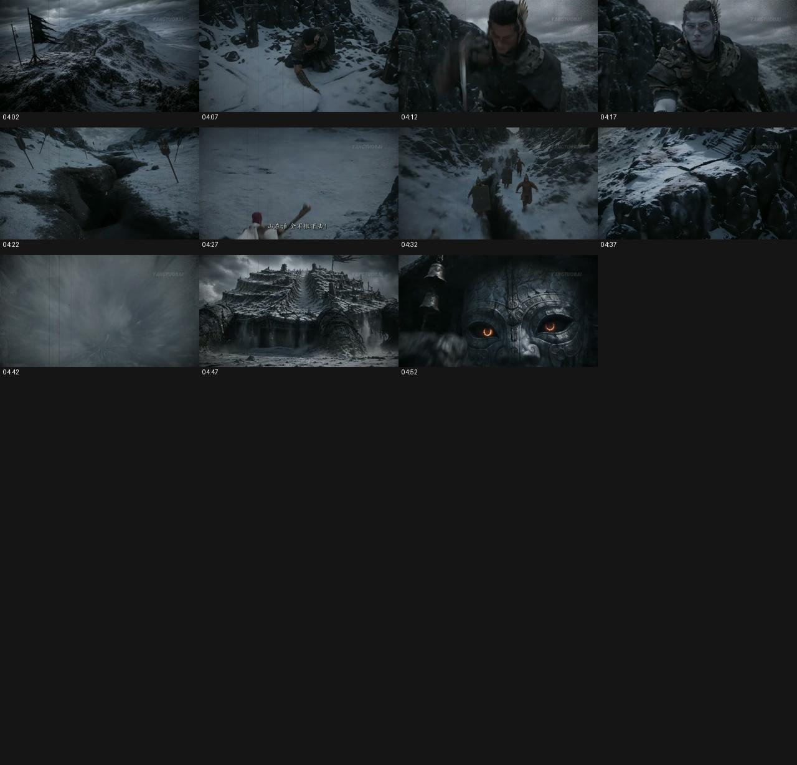
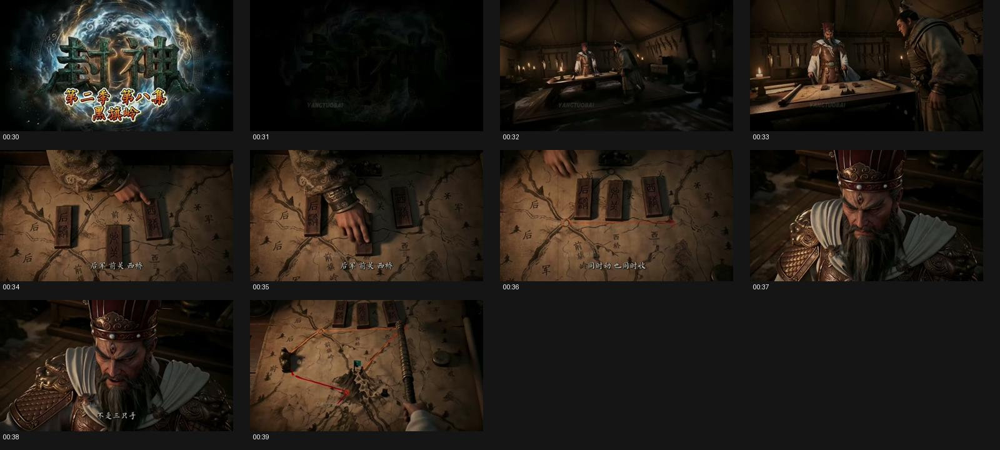
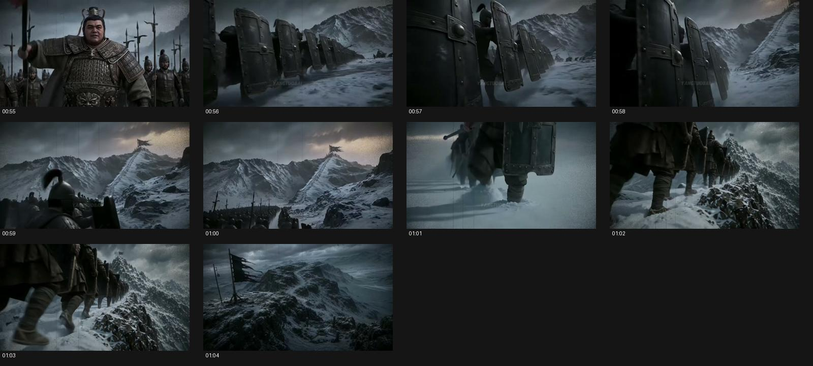

# 两条参考的视觉研究 · v1

研究日期：2026-10-16。用途：五丈原故事视频的分镜、Prompt 与参考图规范。

## 来源与证据范围

- [《合龙》· 2XLabs](https://www.douyin.com/video/7676103932166425919)，网页与本地媒体时长约 17:08。
- [《封神北海篇》黑旗岭片段 · Yangtuobai](https://www.douyin.com/video/7669261124479141738)，网页约 04:54，本地媒体约 293.83 秒。发布标题称由小云雀 Seedance 2.5 制作；这是发布者说明，不是本研究对制作流程的独立核验。

已读取网页、取得可解码的原片视频轨，并检查覆盖首尾的抽帧总览：《合龙》每 30 秒一帧，共 35 帧；《北海》每 5 秒一帧，共 59 帧。另对下列四段各检查 10 秒、每秒一帧的连续图格。时间标记为抽帧位置，约有半秒取样偏差；不是精确剪辑 EDL。

这是一版有画面证据的视觉研究，**没有完成逐帧审片和完整音轨听辨**。本文件不判断配乐、声音设计、精确台词节奏或原始摄影参数；图格只能支持有限的动作与剪辑关系判断。后续若要严格迁移某段连续运镜或动作，须回看对应完整片段，不能用静帧猜测。

本地原片和抽帧留在项目 `source-art/video-style-study-20261016/`。本技能 assets 中保留可独立阅读的图格。参考画面用于研究，不是本项目生成的角色图，也不是可直接替换游戏视频的成片素材。

## 《合龙》：整体视觉方向

观察：人物肤色、发丝、布衣、木器与自然环境具有摄影式的明暗和纹理；童话或奇幻内容置于这样的世界中。东方奇幻与实拍质感可以并存。不能将其概括为全片冷暗战争风。

观察：色彩随场景发生变化。室内与火边有局部暖光；林间偏草木色、光束和雾；水下与部分危险场景偏冷青；后段又可出现明亮的日外。统一性来自材质、光照和叙事摄影，而非每镜同一层色罩。

| 抽帧/区间 | 可见证据 | 对五丈原的迁移建议 |
| --- | --- | --- |
| 02:00–02:09 | 双人关系转女孩近景，再转带肩背前景的男子近景；男子表情、视线和起身状态变化，女孩伸手后仰看 | 交涉镜头让对方反应影响切点，先建立站位与视线 |
| 03:00–03:09 | 临水村落远景、叶尖水滴、林间人物负物行走、饮水近景，继而到水边空间 | 用环境—局部—人物动作形成可居住世界；不把风景镜头堆成空镜合集 |
| 05:35、06:05、06:35 | 火边人物、洞内纵深与火光；不同景别共享局部暖光 | 军帐也应有可理解的光源、前后层次和生活痕迹 |
| 08:05、08:35、09:05 | 手部物件、老年人物侧脸与儿童群像 | 关键物件和反应能承担信息，不必全由正面台词说明 |
| 10:35、13:05、13:35 | 冷色人物近景、水中人与巨大生物、眼部特写 | 仅借尺度与细节关系；是否出现超自然内容服从游戏剧情 |
| 15:35、16:05 | 开阔水岸、纸张物件与人物背影 | 情绪落点可以留给场景和关系，不必收在正面英雄像 |

## 《北海》：战争与军帐的镜头组织

观察：外景以灰冷山地、盾阵、旗帜和狭窄通道呈现军事空间；帐内暖光、地图与将领形成清晰的尺度切换。脸、衣甲和地表纹理强化体积，但神话造型不应一并迁移到三国。

| 抽帧/区间 | 可见证据 | 对五丈原的迁移建议 |
| --- | --- | --- |
| 00:12、00:22 | 轮轴、车辆与推车士兵的低位近景 | 用负重、地面和器械接触表现队伍真实存在 |
| 00:32–00:39 | 帐内关系镜头 → 两人围桌 → 手在地图上移动军牌 → 将领近景 → 地图 | 军事信息先有实际载体，再切决定者与反应；地图文字另行准确制作 |
| 00:55–01:04 | 将领、成排盾牌、山岭目标、贴地步履与纵列交替 | 让玩家看懂目标在哪里、士兵如何到达、地形如何限制行动 |
| 01:17、01:27、01:47 | 雪地狭道、成排弩机/军械、士兵脚步 | 战场由可行动的通路和器械构成，不能只拍无边人海 |
| 02:22、02:32、02:37 | 将领站位、盾阵与狭道关系 | 多人调度保持队列位置、视向和行进方向 |
| 03:37、03:42、04:22、04:32 | 脚下结构、俯视狭道、地面裂隙与队伍移动 | 动作后果要回到空间里；本片法术与灾变不作为五丈原默认剧情 |

## 对游戏的导演判断

以《合龙》负责人物、材质与情感关系，以《北海》补充军营、队列与地形组织。真实感优先落实在身份一致、光照一致、身体与道具接触、材质受力、细微表演上。摄影语言服务原剧情信息，不以增加奇观作为重构的默认方向。

后续待剧情到位再决定：具体场景时长、可见人物、镜头数量、台词、天气与昼夜、现有视频保留范围、参考图是否需要新生成。现阶段没有给这些事项虚设答案。
