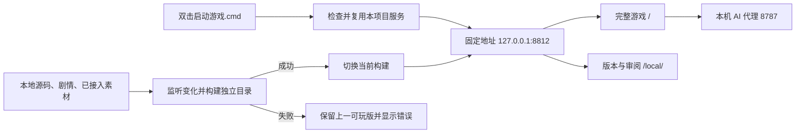

# 本地游戏访问架构

## 日常入口

首次在工作区根目录安装依赖：`npm.cmd ci`。以后双击根目录的 `启动游戏.cmd`。可以右键为它创建桌面快捷方式；快捷方式指向启动器，能在重启电脑后重新启动服务。

| 入口 | 用途 |
| --- | --- |
| http://127.0.0.1:8812/local/ | 本地中心：当前构建时间、构建编号、剧情版本、AI 服务状态及各入口 |
| http://127.0.0.1:8812/ | 当前成功构建的完整第一章 |
| http://127.0.0.1:8812/chapter-one.html | 同一完整游戏，兼容原地址 |
| http://127.0.0.1:8812/art-review.html?style=cinnabar&scene=thoughts&font=kai | 历史配色对照样张；曲线脑图、楷体与新思绪交互已接入完整游戏 |
| http://127.0.0.1:8812/video-review.html | 当前视频审阅页面；不改变台账审批状态 |

浏览器书签只负责打开网页，服务停机时不会自行启动。双击启动器会先启动或复用后台服务，再打开入口中心。关闭终端或 Codex 不作为日常服务的生命周期；电脑关机后，下一次双击重新启动。不安装开机启动项。

## 架构

- **源码层**：继续使用现有 TypeScript、`content` JSON 和素材清单，不再复制出多套手工维护的试玩项目。飞书文档和新生成但未接入清单的素材，需要先同步到本地工程才会成为游戏内容。
- **构建层**：约每 1.2 秒检查文件变化；编译期间的连续修改会合并为下一次构建。目录包含 `web-demo/src`、`public`、相关游戏脚本、剧情数据、视频 current 和美术清单的实际引用文件。先构建到独立目录，再切换；失败不覆盖上一成功版本。
- **访问层**：所有入口统一使用 `127.0.0.1:8812`；不自动换端口。静态响应禁用缓存，页面显示构建编号与完成时间。编号代表成功构建，剧情编号代表实际脚本与流程内容哈希；不把最后一次 Git 提交当成本地最新修改。
- **更新提示**：游玩中的页面发现新构建后提示刷新，保持当前操作；启动器和版本提示均不写入玩家存档。新页面进入当时的成功构建，旧页面只有刷新后才能完整采用新版。
- **AI 层**：启动时复用兼容的 8787 服务，或在端口空闲时启动已有代理。不修改 AI 判定逻辑或密钥。只读 `/health`；“已配置”只表示存在配置，不代表实际模型调用已验证。
- **状态层**：游戏存档继续留在原浏览器 localStorage。同浏览器、同 `127.0.0.1:8812` 地址才能继续原进度。8811、localhost 或另一浏览器的存档不会自动合并。

当前维护源码的是一套工程；完整游戏已接入曲线脑图与楷体，界面样张继续作为三套配色的历史对照。新的物品栏与思考交互请从完整游戏验证。

## 开发及维护

| 命令 | 行为 |
| --- | --- |
| `npm.cmd run open` | 后台启动或复用服务，并打开本地中心 |
| `node tools/local-game/launch.mjs --no-open` | 后台启动，不打开浏览器 |
| `npm.cmd start` | 在当前终端运行同一服务，Ctrl+C 关闭；不要与后台实例重复运行 |
| `npm.cmd run stop` | 关闭本项目管理的服务与它启动的 AI 子进程，保留玩家存档 |
| `npm.cmd run build` | 保留原一次性构建流程，用于独立构建和现有测试 |
| `npm.cmd run test:local` | 验证成功切换、失败保留、连续修改、重启恢复与安全清理 |

`GameStarter` 中的 `start:demo` 是原一次性构建加静态服务，不带中心或自动更新，默认端口也统一为 8812。日常请使用根启动器；如有旧实例占端口，先在其原终端关闭。启动器不会终止未知进程。

`DEMO_PORT` 可供开发测试临时覆盖；日常固定 8812，以免切换存档来源。自动启动的 AI 代理固定 8787，保留原 `GAME_SETTINGS_FILE` 配置支持。`LOCAL_GAME_NO_API=1` 仅用于隔离测试或明确不需要代理的开发会话。修改启动器、代理源码或 `.env` 后，停止并重新启动服务；游戏代码与已接入素材则自动构建。

不同开发端口的缓存隔离在 `.cache/local-game-端口号/`，不会竞争日常 8812 服务的构建指针或停止令牌。

运行状态及日志均在 Git 忽略的 `.cache/local-game/`：

- `launcher.log`：后台启动与状态日志；前台 `npm start` 则直接显示在终端。
- `build.log`：TypeScript、素材绑定错误及构建结果。
- `api.log`：本次启动的代理日志。
- `current.json`：最后成功构建的编号与时间，供重启恢复。
- `builds/`：当前和上一成功构建。自动清理只操作本目录下经过实际路径校验的构建目录。
- `control.json`：本机停止服务的令牌，不分发、不提交。

端口被占时显示明确错误，不悄悄换地址。若构建失败，在中心查看状态并检查 `build.log`，修复源码后会自动重试。没有密钥时仍可启动游戏、查看界面和使用固定文本流程，AI 自由表达需要有效配置。

## 验证边界

2026-10-22 在本机 Windows 中文工程路径完成：

| 检查 | 结果 |
| --- | --- |
| `node --test tools/local-game/builds.test.mjs` | 构建失败保留、修改合并、持久恢复、HTTP 切换、限制清理范围、端口归属与独立工作目录 |
| 根 `启动游戏.cmd --no-open`、后台重复启动 | 启动成功并复用同一 PID |
| 停止、重新启动与 `/__local/status` | 旧进程关闭，新进程启动并正常构建；AI 子服务正常启动 |
| `node tools/local-game/smoke.mjs` | Chrome 独立上下文通过；桌面与手机宽度、主菜单、界面样张、视频 Range 响应正常，无页面异常或 404 |
| 实际编译失败与恢复 | 测试临时添加唯一命名的错误 TypeScript 文件，旧游戏仍返回 200；移除后自动构建，提示手动刷新，存储不被版本提示改写 |
| 桌面快捷方式 | `逆转五丈原-本地试玩.lnk` 指向根启动器，工作目录固定为本工程 |

浏览器截图和检查结果位于 Git 忽略的 `outputs/local-game-access/`。冒烟脚本会短暂制造一次编译错误并自动清理，只适合开发验收时执行。

兼容性处理：修正 8811/8812 启动说明冲突（doc-mismatch）；将工作目录与中文路径作为实际启动验证项（risk）；为失败构建覆盖当前游戏和重复启动补上检查（test-gap）。保留原静态服务及一次性构建供既有测试、打包使用，未删除与本任务无关的历史工具。共享 Node 工具使用路径 API 和参数数组，macOS 原生启动未验证。此入口可在本机 Windows 使用；Cocos 编辑器与 Windows EXE 不属于本次验证范围。
