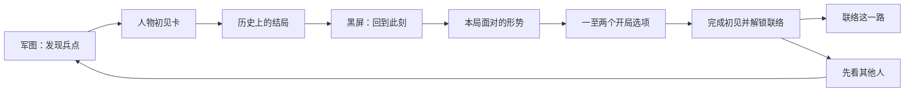

# 第四章｜兵点初见与人物解锁架构

2026-11-18。状态：架构提案，待用户审阅；未接入运行。具体历史叙事、当前处境、选项原文和效果由各人物剧情分别对接。本稿不替代已确认的人物动机与营救条件。

## 1. 玩家体验

章节开篇结束后回到军图，推荐初见顺序为 **傅肜 → 沙摩柯 → 冯习、张南**。冯习与张南共用旧营兵点和一次初见，故事内分别表现两人，解锁后沿用一个联络页。引导提示点击地图上的兵点，不先给玩家三个可交谈的人物页。

初见卡显示人物姓名、所属兵点和画面，以及“了解这一路”的入口。完成前使用“人物初见”，完成时才显示“已解锁联络”，避免把发现兵点误当作已经解锁。

首次引导按上述顺序推荐下一处；顺序属于引导，不是营救优先级。地图上其他已发现兵点也可查看，不要求先救傅肜才能了解沙摩柯。玩家可中途退出初见，回到军图，下次从原位置继续。

## 2. 每个人物的初见内容

| 段落 | 表现与作用 | 完成条件 |
| --- | --- | --- |
| 人物初见卡 | 姓名、兵点、一张写实画面；不提前显示完整问话和传令对象 | 点击进入 |
| 历史结局 | 清楚标注“史书记载”；只讲已核实史实，不把本局改写当成历史 | 图文读到最后一页并继续；视频完成对应段落 |
| 黑屏转场 | 短暂黑屏，用一句桥接文字区分历史结局与眼前可改变的局面 | 图文版主动继续；视频版按已配置演出衔接 |
| 当前形势 | 讲清人在何处、为何受困、当下最需要处理的问题 | 图文读到末页；视频完成对应段落 |
| 开局选择 | 最多两个选项；可以包含“先看其他人” | 明确选定，并由服务端确认一次 |
| 解锁反馈 | 地图出现危机度，下方出现人物联络页，传令目标可选 | 完成记录、选项效果与解锁同次保存成功 |

未来每位人物整段演出以约1～2分钟为目标，历史段与当前段不强制各占一半，时长由剧情决定。现在只定义图文结构，不补写尚未交付的历史正文或假视频。未交付段落仅能在开发预览中标明“待补”，正式体验不能把空段落算作已看完。

图文与视频共用同一组段落编号、完成状态和末尾选项。替换媒体只更新素材引用，不能重新授予选择效果。视频中的对白不在结束后再整段重复播放；文字回看属于用户主动查看。

## 3. 解锁、营救决定与行动分开

“完成初见”定义为历史段、当前形势段都完成，并确认末尾选项；仅点击兵点、进入卡片或开始播放都不算解锁。

| 状态 | 地图 | 下方联络与传令 | 军情调度 |
| --- | --- | --- | --- |
| 已发现，未看故事 | 显示可点的初见标记；不显示完整危机与军情 | 没有该人物页、推荐问题或目标选项 | 仍只显示自己的接应兵力 |
| 故事中途退出 | 标记“继续了解” | 仍未解锁 | 不增队、不扣兵 |
| 已看完，选择尚未提交成功 | 保留末尾选择，允许重试 | 仍未解锁 | 原状态不变 |
| 已解锁，先看其他人 | 显示人物、位置、危机度 | 加入人物页及可选目标，保留“待接应”状态 | 不自动出征 |
| 已解锁，决定联系营救 | 同上 | 打开该人物页，呈现初报与推荐问题 | 仍需独立确认军令才派兵 |

初见选项表达的是态度、情势或后续查看方向。选择“设法接应”不等于军令下达、不占用甲队或预备兵，也不自动取得“护送到位”等事实。

“先看其他人”默认不增加危机、不关闭本轮营救资格、不等于永久放弃。之后随时可返回该人物页。若剧情需要“本轮拒绝营救”或永久分支，必须另行明确配置后果，不能藏在导航选项里。

没有人物解锁时，下方只显示一句“先查看军图上的兵点”，输入与传令暂不可用。首个人物解锁后才开启问话和传令操作引导；不再一进地图就播放完整的四步教程。

## 4. 开局选择与危机度

选项配置同时包含“剧情效果”与“下一步去向”，两者分开。每处最多两个选项；默认可以是一个剧情回应、一个“先看其他人”。此处只留接口，不把示例当成正式对白。

- 每处保存本局开局危机基值与唯一选项效果。当前运行基值傅肜96、沙摩柯84、旧营88，可作为无效果分支的暂用值；最终随人物剧情和数值验证确定。
- 新局开场危机度仍在用户要求的80～100之间。选项效果不是随机重掷；同一选项重试、刷新或回看不能叠加。
- 初见回应只影响明确配置的初始因素，不能授予刘备消息已核实、接受撤离、道路已探明或接应已到位等需要实际事件的事实。
- 危机必须参与真实营救结算，不能只修改地图数字。当前沙摩柯与旧营的危机主要是进度显示，傅肜另有核心危机算法；接入时须分别把开局因素纳入实际计算，并验证收益。三路不能只套一个显示偏移量。
- 先给每个分支定义有剧情依据的因素，再决定具体增减值。当前不预设“正确选项减10”或对暂缓查看加惩罚，不引入尚未测试的通用奖励。

初见阅读、视频与选择不推进战术轮，不占问话／军令的10秒间隔。服务端只在实际聊天、军令确认时开始该间隔，只有“结束本轮”推进战场。

可以在不推进回合的情况下先了解三路。首个联络解锁后允许开始调度，无需强制连续看完三部影片。若玩家已推进战术轮，再去了解其他兵点，这些兵点继承全局已过轮数和压力；解锁不能让战场重置到开局，也不能用保持未解锁来冻结危机。

## 5. 历史信息与本局事实隔离

历史段是给玩家看的历史背景，不自动写入本局人物的知识、AI上下文或可出示情报。历史死亡不能把本局人物设为已死，历史结局也不能自动满足营救条件。

当前形势段如需授予一条情报，必须配置实际来源、获知者和交付时点。没有配置则只完成叙事展示。傅肜的核实消息与说服条件继续走现有规则，不因初见影片被跳过。

## 6. 存档与媒体完成规则

人物初见按本局 `scenarioId` 保存，不能仅复用全局“看过某影片”的浏览器键来解锁。本局初见状态与演出版本绑定，已经生效的选择另有独立记录。

建议保存的数据：

| 数据 | 用途 |
| --- | --- |
| encounterVersion / contentVersion | 状态结构版本与本局采用的故事版本 |
| frontId | `fu`、`sha`、`camp`，独立于接应队编号 |
| stage | available、history、present、choice、unlocked |
| segmentId / pageIndex / playbackPosition | 退出与刷新后的续看位置 |
| completedSegments | 记下哪些段落已完成，加载失败不计完成 |
| selectedOptionId / effectReceiptId | 防止选择和数值效果重复应用 |
| unlockedAtRound / preferredNext | 何时解锁、接下来联系此人还是看其他人 |

初次视频不提供“跳过并解锁”。允许暂停、续看与返回军图；无障碍图文版完成同样的必要段落也可解锁。原通用播放器的“跳过动画”不能直接连接初见完成回调。仅拖到片尾不能视为已完成所有必要段落；以播放进度和必要段落完成记录共同判定，允许回看与倍速。目标是明确流程完成，不设计反作弊式观看计时。

播放失败保留位置，提供重试；只有准备了内容等价且已审阅的图文版时，才提供切换阅读。关闭、出错、自动播放被阻止都不触发解锁。旧媒体的迟到回调与已关闭故事的回调不能改变当前人物。

视频加载、播放、暂停与片段切换期间，由演出统一持有背景音乐暂停状态；最后退出整段演出后才恢复游戏音乐，影片原声音正常播放。未来人物影片位于iframe时，需要受控的同源父子消息或统一演出宿主；不能仅依赖父页面查找自身的video元素。

旧局已经存在的联络、军令和派遣必须保留，迁移时记录为 `legacy-open`，不虚构“看过历史段”，不补发选项奖励。新局才从未解锁开始。素材小修不重锁已解锁人物；会改变分支含义的故事版本需有明确迁移策略，不能无声重算旧局。

## 7. 与现有代码的接口

本方案先落在已有三路军令场景，不把这一路径的解锁当成原九路第四章通关；以后整合由章节入口负责。

| 位置 | 实施时的变化 |
| --- | --- |
| 人物初见配置（新增） | 每个人物的历史段、当前段、媒体引用、选项、效果与内容来源；配置与状态分开 |
| 初见状态模块（新增） | 纯状态迁移、段落完成、唯一选择、解锁判定与迁移；可独立测试 |
| `campaign-engine.mjs` | 新局不一次发出三路初报；解锁成功才发对应初报；以真实规则读取初见效果 |
| `campaign-runtime.mjs` | 新增初见开始／进度／完成／选择操作；沿用请求编号、版本比较、互斥执行与原子存档 |
| `publicSession` | 只返回已解锁人物的完整军情、消息和可传令目标；未解锁只返回初见所需公开信息 |
| `campaign-app.ts` | 地图兵点有发现、续看、已解锁三种表现；人物页与目标下拉按服务端解锁列表生成 |
| `campaign-intent.ts` 与服务端军令校验 | 文本直接点名未解锁人物时提示先了解该兵点；不得绕过界面或把失败目标自动改成别人 |
| 共享媒体宿主 | 图文与视频使用同一初见流程；完成、退出、错误是不同回调；与章节开篇播放器分开记进度 |

选择提交必须在同一事务内完成：校验本局与故事版本 → 校验必要段落 → 固定选项 → 应用一次效果 → 标记解锁 → 发布初报 → 返回可见目标。重试同一请求返回原结果；两个窗口同时选不同项，后到者读回既定结果。

聊天、批量军令、手选目标、自然语言识别和傅肜AI上下文都检查解锁。批量军令含未解锁目标时整批拒绝，指出对应兵点，不先扣掉其他队伍兵力。退出初见或回看不再产生效果请求。

## 8. 各人物剧情对接模板

用户只需交付自然语言内容，编号、配置与技术字段由执行者整理。

| 需对接的内容 | 傅肜 | 沙摩柯 | 冯习、张南 |
| --- | --- | --- | --- |
| 初见人物与地点 | 后阵；既有设定保留 | 东沟／西沟；既有设定保留 | 旧营；共用兵点，区分两人 |
| 历史上的真实结局及依据 | 待剧情方交付、核实 | 待剧情方交付、核实 | 待剧情方交付、核实 |
| 从历史转到当前的一句话 | 待交付 | 待交付 | 待交付 |
| 当前形势与角色知道的事实 | 待交付；不能跳过核实与说服 | 待交付 | 待交付 |
| 一至两个选项原文 | 待交付 | 待交付 | 待交付 |
| 每项希望改变什么、为何改变 | 待交付；程序与数值方案再评估 | 同左 | 同左 |
| 下一步联系此人／看其他人 | 可配置 | 可配置 | 可配置 |
| 图文画面、之后替换的视频 | 待指定正式素材 | 待指定正式素材 | 待指定正式素材 |

现有写实初报图表现的是向导、军吏、传令兵，不能改标签后冒充人物本人。历史素材与叙事后续按项目史料核对与写实影像规范制作；本次未制作图文正文或视频。

## 9. 接入后的验收项

1. 新局只有兵点初见入口，没有提前出现的三路人物页、初报、危机数值或传令目标；甲队500人与预备兵2000人照常显示。
2. 点击兵点但没看完，关闭、刷新或故障后都不解锁；已完成段落可续接。
3. 看完并选择后，只解锁当前一路；“先看其他人”仍解锁、不自动派兵，也不额外加危机。
4. 推荐次序为傅肜、沙摩柯、旧营；不会要求先成功营救才能继续认识人物。
5. 选项重试、回看、双窗口竞争都不能重复生效；初始数值在80～100内，后续危机按真实回合和行动计算。
6. 未解锁对象不能通过直接API、自然语言、批量军令或下拉选项绕过；被拒军令不扣兵、不开始冷却。
7. 初见播放不推进战术轮；已进行战斗后再解锁不重置其他战线时间、压力或兵力。
8. 历史结局不写成本局死亡或已知情报；傅肜的核实与说服仍需实际完成。
9. 图文换视频后进度可恢复；加载、暂停、换片、退出无背景音乐叠播；原影片声不被一并静音。
10. 各人物选项配置完成后再进行真实数值模拟：分别比较营救顺序、暂缓查看、初见选择与现有难度；不能拿此前兵力平衡模拟当成本机制已验证。

本次仅完成现有实现核对与架构整理。尚未实现上述解锁、状态接口、媒体流程或数值效果，也未执行本方案的玩法测试。
