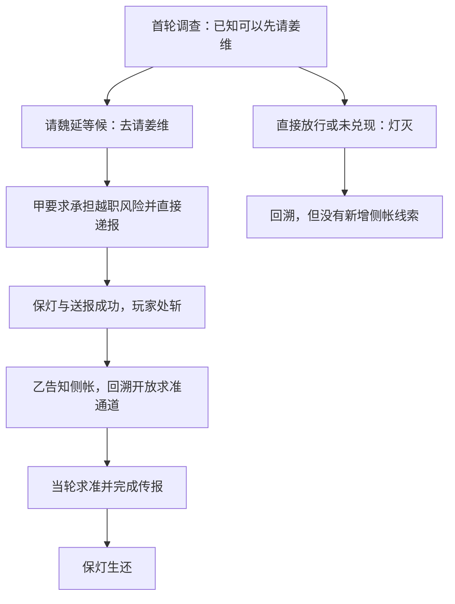

# 五丈原：主线因果完整审稿

> 2026-10-11 用户纠正工作范围：需要搭建由用户亲自审核的 HTML 剧情工作台，并新建【剧情审稿】对话。本文为此前自行审稿的历史记录，用户未采纳其中判断或候选改法；不能将本文作为修改剧情的指令。当前审稿入口与协作以 `../docs/剧情审稿_工作台与协作.md` 为准。

2026-10-11。用户选择“先按主线因果完整审一遍”后，由主产品经理完成。本文是结构审稿与修改建议，候选梗概尚未成为新剧本。

## 审稿结论

本章有成立的核心冲突：玩家知道魏延入帐会吹灭灯，魏延却有必须立即送达的军情。玩家必须同时解决保灯与传报。现代人的先知、军营里有限的身份、NPC各自合理的职责，也能形成有趣的交涉。

目前最影响可信度的，是三个相互依赖的桥段：**玩家请求去请姜维，被后续对白算成已擅改传报；军报送达、灯被保住之后，直接处斩；可以先求准的侧帐，只在处斩后开放。** 正确办法已被甲说出来，程序却要求玩家走完致死路线才提供实行它的通道。玩家学到的容易变成“先触发死亡，才能开下一处地点”。

建议优先重写“首轮介入—首次结果—新发现”。保留急报、魏延的职责、帐外解决问题和跨轮记忆。首轮合理求准应有可执行的回应；回溯的价值来自发现、时机与新的行动顺序。若坚持“第一次救灯却死”，需要另行建立死亡的完整因果，现有对白润色不足以解决。

## 审稿依据与边界

- 运行来源：`../content/chapters/wuzhang/chapter.json`。审阅快照为47个对白节点、4个场景、5项证据、11个动作；SHA-256：`f15e8c5ad1bdb710072e8e990cbd49bd84a0f9f8a31a94c00aaf912262889731`。
- 核对了运行内容的场景开放、交涉条件、承诺、事件及结局，并参照叙事引擎与页面的入口逻辑。阅读稿和旧Review有滞后；此次以运行内容为准。
- 当前运行稿已新增甲的线索关联、误传军情与添令纠正、病势调查，也明确区分报名候见与改变传报办法。以下判断已经计入这些改动。
- 这是文本与静态规则审查。本轮没有重新试玩全部路线、提交真实AI输入或做陌生玩家测试；“规则未提供某行动”不等于已实测AI如何拒绝它。
- 不新增历史断言。处斩、甲乙及具体传报制度按游戏补写审查；架空说明能够标明来源边界，仍需让事件在本故事内可信。

## 一、完整主线的因果检查

| 段落 | 玩家为何行动 | 当前结果与推进依据 | 审稿判断 |
| --- | --- | --- | --- |
| 电视前进入军营 | 看见灯灭，想阻止已知事件 | 来到第六夜傍晚，成为守门小卒 | 目标清楚、介入时点有效；超自然设定可以简短建立 |
| 调查甲、告示、斥候、帐内动静 | 需要知道身份限制、军情与接报人 | 急报真实；告示只禁闲人；姜维在内；丞相咳嗽 | 信息各有用途，魏延的行动获得合理性 |
| 向甲关联线索 | 需要把保灯和传报放在同一方案内 | 甲认可“人不入帐、急报及时递入”，要求先请姜维 | 思路成立；此时已经明确求准办法，后续必须接得上 |
| 首轮请魏延暂等 | 争取向姜维请求接报的机会 | 魏延同意“你去请姜维”，明确尚未得令 | 这个承诺本身合理，尚未等于擅自改换接报人 |
| 返回甲兑现 | 玩家预期去请姜维 | 甲称玩家已许诺换自己接报；仅可承担风险交报或作罢 | 行动意图发生错接；缺少真正先请示的选项 |
| 军报送达、保灯、处斩 | 继续承担甲告知的风险 | 姜维出帐处置；执行者直接宣判；乙提供侧帐线索 | 处斩缺少足够的责任事实和戏剧过程；提示揭示结局也削弱惊变 |
| 回溯后访问侧帐 | 按乙临死所说先取得许可 | 侧帐、乙的代问能力终于可用 | 地点知识是新信息，但常规求准通道为何必须通过死亡才可发现，缺少故事理由 |
| 乙代问、姜维批准 | 给及时传报建立可靠安排 | 获当夜有限准信；告知魏延，邀请乙到场 | 许可范围清楚；必须本轮重取许可合理 |
| 交报、取回话、转达 | 兑现承诺，让军情与命令往返 | 正确复述完成；误传和添令耗时；失约则灯灭 | 准确传话有意义；玩家在乙、魏延都到场后仍承担中间转述，需要职责说明或合并 |
| 保灯生还、继续咳嗽 | 检验这一夜是否改变，并追问更早原因 | 当前成功被承认；病因未解；后续章节入口尚是占位 | 余韵方向成立；后续需有可追查的事实连接，现阶段不宜直接推出具体病因 |

当前规则形成的关键路径：

这里的“必须死亡”指**当前安全路线的前置条件**。游戏也允许玩家活着回溯；活着回溯不会绕过安全路线对处斩记忆的要求。

## 二、逐项问题与修改建议

### 1. 请求许可被改写成擅自安排，首轮承诺与兑现不一致【核心：确定的错接】

依据：`weiyan.negotiate`预设表达是“尚未得令，容我去请帐内姜将军接报”；魏延答“你去请姜维”。随后`guard.risk`却说：“你已许了魏将军，要换我接下军报，把他留在帐外”。甲此前还明确说过“报名候见，是守门的本分”。

玩家并未承诺甲已经获准接报，后续却把这个行为当成已发生的安排。自由输入判定规范同样接受“自己去帐门请求姜维接报，明确尚未获准”，所以这个错接会影响固定选项与AI交涉共同的主线。

建议：将“请求接报安排”与“未经许可直接改换传报”拆成两个真实行动。返回甲后，至少回应先请示的请求；如果此时不能实行，给出具体情境原因和可尝试的替代方法。只有玩家明确选择后者，后续才可追究后者的责任。让甲复述玩家实际答应的内容。

验收问题：玩家说“我尚未得令，只想先替他报名请示”，接下来的对白和动作能否始终承认这句话？

### 2. 处斩缺少足以支撑它的行为、损害和追责过程【核心：因果铺垫不足】

依据：`direct.deliver_report`后，`event.direct_execution`只要求直接路线、未经许可转报、军报送达、灯仍亮。`ending.execution`先演出姜维出帐处置，再由执行者说“未奉军令，擅改急报传递，罪责已定”，即押下处斩。

当前演出里没有出现扣报、假传军令、战情受损等更严重事实，也没有具体人物作出判断的过程。甲既明知、协助并禀明，责任如何区分也未解释。按本故事已提供的信息，后果的严重程度难以理解。

此外，甲的选择提示已直接预告“将导致处斩”。这使首次惊变成为玩家明知必死的流程选择。玩家如果拒绝承担，也没有得到先求准的出路。

建议：先决定死亡承担什么戏剧功能。若目标是展示介入造成的新代价，代价必须由玩家的具体行动引发并可理解；若目标只是让玩家认识请求许可，应调整首次结果。把“处斩”换成轻罚，或多加一句“军法严苛”，都无法独立修复第1、3项。保留处斩版本时，还要写清决定者、责任事实、为何救报后仍无法补救，以及甲乙姜维为何没有介入。

### 3. 求准的途径必须先死才能发现，主线阻碍来自入口条件【核心：结构问题】

依据：`relay_tent.visibleWhen`、`relay.send_request`及乙交涉的认可条件都要求`memory.seen_execution`和`memory.knows_relay_tent`。乙临死时说的是“先来侧帐找我……问得姜将军准信，再办也不迟”。甲首轮也已经指导先问准。

侧帐是当时就存在的普通传令地点，乙具备常规代问能力。当前没有交代玩家为何不能问甲“谁能代问、在哪里”，也没有解释甲为何指导求准却不告诉通道。灯灭失败的结算甚至明确没有新侧帐线索。一个谨慎的玩家可能反复失败，也永远得不到正确通道。

建议：允许通过首轮打听、观察传令活动或失败后的在场见闻发现乙。若还希望回溯有强烈价值，把新发现放在**何时找乙、他当时在做什么、需要怎样提前安排**，并在本轮实际发生的事件中铺垫。死亡若仍是必要条件，要揭示确实只能在那个事件里获知的重要事实；一般地点和常规求准方式不足以承担这个作用。

### 4. 证据被混同成统一门票，部分出示缺少对方改变判断的理由【重要：用途不足】

依据：魏延首轮要求出示告示和斥候军情；授权后要求准信与斥候军情。乙的认可条件也要求告示、斥候军情。两处还依赖玩家先在甲处完成`guard.connect_evidence`，获得`loop.inferred_plan`。

告示说明限制，军情帮助玩家理解急迫性，准信证明可靠安排，三者作为玩家推理材料成立。但魏延自己带来同一份急报；出示斥候军情为何再次改变他的判断，尚不清楚。已经获准、安排可靠的情况下，没有再次展示该证据仍不能通过，容易被理解为集齐并排列卡片。

甲的新推理环节有教学作用，认可正确思路也比单纯集齐证据更好。但玩家如果已在自由表达中提出同样的方案，仍要先回甲处点击一次才具备认可条件，推理就容易变成额外手续。第二轮记得该认识后还重做同一题，尤为明显。

建议：分别定义争议。魏延需要相信“军情不会被压下，接报与处置有可靠着落”；乙需要确认“请求内容和当时事实”；姜维准信解决授权。只有对当前争议有作用的证据才要求当面出示。允许等价推理获得认识，或把甲的推理题保留为求助路径。跨轮记忆保留推理结论，同时仍须重新获得当夜许可、确认会变化的军情。

### 5. 安全路线后半段，玩家职责与往返步骤的必要性不够清楚【重要：人物行动与节奏】

依据：`relay.invite`把乙带到候报处；`weiyan.handoff`中魏延已经直接对乙交代军情。乙递报返回后，仍由玩家听姜维原话，再转述给同处候报处的魏延。

准确复述、拒绝夸大与擅添军令是有价值的选择，现稿新增这些错误后果是进步。但乙既是专业传令人，又与魏延在同一地点，为何不能直接回话？如果主要目的是让玩家确认每个动作，这段演出对主角的需要就显得较弱。

建议：明确玩家是接报链中的哪个角色，并在获得许可时确立职责；或者让乙向魏延直接交接，玩家承担一个确实会改变局面的确认、纠错或协调决定。合并没有新信息和新风险的往返演出，保留需要兑现的承诺、准确报告及实际送达。正常流程可以连续演出，也仍能记录动作完成，叙事和技术无需一一对应点击。

### 6. 回溯带来的优势主要是开放地点，经验还没有充分改变策略【重要：核心体验】

依据：次轮仍需取得告示、甲证词、斥候军情，完成甲的推理认可，再到侧帐交涉。关键优势是侧帐可见。NPC不记得上一轮、旧许可失效，这两点合理。

建议：让记忆改变行动顺序和提问。玩家可直问甲怎样报名、提前找乙、针对上一轮误解澄清、只重查会变化的事实。复访可以简短确认并拿到本轮有效依据。固定环境信息、已理解的道理与本轮有效许可分开设计。第二轮应让玩家看见“我知道得更多，所以做法变了”。

病势调查值得保留：它让玩家选择当下履约或追查更大的原因，且显式告知耗时。普通失败也应带来与具体失败有关的认识；不必让每次失败发同一线索，但应避免谨慎尝试永远没有学习出口。

### 7. 回溯独白的出现条件与叙事时点不一致【局部：确定的条件问题】

依据：`player.return`要求存活、当前未结局、`memory.seen_intro=true`，没有检查已经发生回溯。开场结束后这些条件已经成立，玩家可在首轮触发“夕阳、帐门……像从未见过。只有我还记得……这一回，得先问准了再办”。引擎按节点条件列出话题，页面未对该节点另设回溯门槛。

这是静态可达性判断，尚未在页面复现。建议用实际回溯记录区分首次与返回独白；再根据玩家究竟经历了灯灭、处斩还是主动返回，写对应回忆，避免让角色记得未发生的经历。回溯能力本身可以采用简短约定，第一次使用时让玩家清楚记忆保留、世界重置，以及回到哪个时点。

### 8. 结尾方向成立，更早病因需要逐步建立线索【后续连接】

依据：`ending.safe`承认灯、军情和玩家的成功，随后演出仍在咳嗽；已经调查病势时才补主角回忆。更早章节当前只提供粮运、谷中失机入口。

建议保留这一夜的成果与咳嗽余韵。将来的章节入口需要由可追查事实引出，例如具体见闻或记录指向一个更早事件；本章只有“早已病着”时，主角可以提出追查，尚不能断言某事件造成了病。接续梗概选定后再安排线索，不必现在为占位入口补结论。

## 三、人物动机检查

| 人物 | 当前成立的行为 | 需要补足的动机或职责 |
| --- | --- | --- |
| 玩家 | 先查清局面，不靠未来预言强迫别人；尝试保灯且不误军情 | 已被教导求准后，为何仍选择明知必死的办法？如果只是为了打开通路，动机无法留在故事内 |
| 甲 | 守门、保护帐内、保证急报；区分报名与改变安排 | 为什么不能协助报名求准、指路乙？为何参与未准转报，随后只有玩家遭重罚？ |
| 魏延 | 急报必须及时处置；不认可禁闲人为扣报理由；等待可靠安排 | 无需重写成冲动反派。等待与恢复入帐的触发，应始终对应急报有无着落 |
| 乙 | 代问许可、准确递报、限定授权 | 有效帮助为何只在临死时指出？人在魏延身旁时，为何还需玩家代传他的回话？ |
| 姜维 | 能处理军情、批准有限传报、随后在帐外议事 | 处斩发生在他已处置军情之后，他对追责是否知情、为何不参与？保留该结局必须回答 |
| 执行者 | 当前用于演出处斩 | 缺少与既有冲突的联系、明确决定来源和责任事实；出现即宣判，难以形成可信因果 |

## 四、玩家自然会想到的办法

下列是审稿反事实，尚未逐条向真实AI提交。应先在剧本中决定回应，再由程序和AI一致实现。

| 玩家表达或行动 | 当前内容的对应情况 | 修改原则 |
| --- | --- | --- |
| “甲，先替魏将军报名，请姜维定接报办法。” | 甲承认报名合乎职责；首轮后续却只有承担风险直接递报或作罢 | 应支持，或给具体、可检验的受阻原因及替代动作 |
| “哪位传令卒能代问？他在哪里？” | 正式代问途径受处斩记忆限制 | 常规人物知识应可打听；特殊时机另作铺垫 |
| “魏将军稍候，我还没有许可，现在去求准。” | 认可此表达后启动直接路线，兑现时被改述为越职安排 | 认可的意图与后续责任一致，不能事后替换 |
| “请姜维出来听报，人不用入帐。” | 已认可帐外解决的总体办法，首轮没有对应求准动作 | 这是核心目标附近的合理建议，应有可信回应 |
| “先控制帘子的开合或挡住风，再让军报照常送入。” | 现有许可与传报路线未覆盖此类方案 | 不必实现无限分支；可依据真实可见的站位、帘子用途、身份限制或设施条件回应，避免仅说超范围 |
| “我记得怎样求准，这次先找乙。” | 安全路线最终确实这样做，但仍需重新完成推理题和一整套调查 | 利用经验缩短已知过程，同时确认本轮有效事实和许可 |

合理替代办法不必全部成功。关键是拒绝由场景和人物引出，玩家能用新事实修正方案；AI不能临时编造一个主线中不存在的拒绝理由。

## 五、优先修改方向

### 推荐方向：允许首轮合理求准，回溯用来修正时机与安排

候选梗概：

1. 玩家来到傍晚，以为只要拦住魏延；调查发现急报也不能耽搁。
2. 玩家向甲或传令人询问怎样让姜维在帐外处置。甲回应实际问题，乙可以通过打听或观察发现。
3. 先向魏延提出等候但没有可靠安排，会遇到明确限度；执意空等、错误转报或放弃接报，让魏延入帐、灯灭。玩家在这次事件中看见接报链具体在哪里断了，并获知可提前改变的环节。
4. 回溯后，玩家利用这一认识，在魏延到来前找乙并取得当轮准信。已知的信息可快速确认，准备顺序改变。
5. 魏延看到可靠安排而等候。玩家完成必要交接，准确保留军情的不确定性，避免擅添命令；军情处理、灯与自身安全都得到保全。
6. 咳嗽留下更大问题，调查病势可以提供后续追查方向。

这是候选结构。第3步的具体见闻、等待界限及乙的活动，要在下一轮梗概中写实。**谨慎且推理正确的玩家可以首轮成功；回溯提供学习机会。** 保留现有角色、地点和主要资产，改动集中在首轮承诺、乙的发现、结局前置及次轮重复流程。

### 另一方向：保留“保灯却死”，重新建立介入导致死亡的因果

保留先前的强烈反转，需要增加一条完整因果：玩家明确选择了什么高风险干预 → 实际造成什么新局面 → 哪个人因何作出反应 → 为什么这一轮无法挽回 → 临死发现什么只有该事件才揭示的关键事实 → 下一轮怎样提前改变它。

这一方向能保留死亡反转，但重写范围较大，也可能牵动角色、演出与玩家行为。具体死亡原因应与用户选定的创作目标一并设计。现阶段不建议直接编造更重罪名或更残酷军法，去维持现有入口条件。

两种方向的核心取舍是：本章是否必须让第一次成功付出死亡。**我的建议是优先采用前一个方向。** 它能修复玩家的合理请求、保留交涉与回溯，现有素材与运行结构也较容易承接。

## 六、下一轮交付与验收

先将选定方向写成一页完整梗概，重点明确首轮请求的真实含义、第一次结果、乙如何被发现和回溯新增的认识。之后再写场景卡与对白，最后映射节点、条件、承诺及AI知情范围。

执行程序负责正式内容和规则实现；AI编剧程序负责等价表达、角色回应与知情边界。两者共同使用同一变更单，避免固定选项允许请示、生成回应却把它说成越职。当前审稿没有向两边派发未定稿的剧情重写。

验收至少覆盖：首轮直接请求报名求准；首轮打听乙；空等、误传与准确转报；灯灭后得到与失败有关的信息；回溯后的提前安排；保留记忆而重取当轮许可；首轮与回溯独白分别正确。数据检查、真实AI输入、浏览器完整路线和陌生玩家理解分别记录。

现有人工编辑稿保留，结构选定后先核对其中用户的改动。运行内容更新后再同步阅读稿和说明，历史验收记录不作为新主线已通过的证据。
