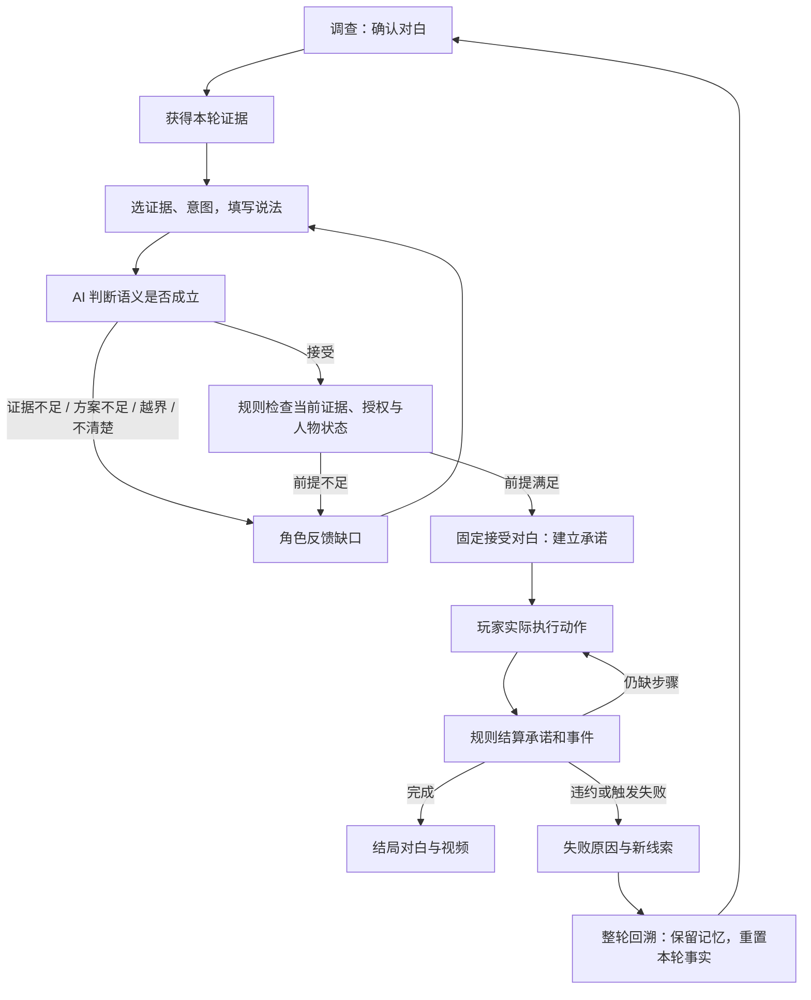

# 剧本对话编写指南与示例 v1

这份文档用于写作与交接，覆盖调查对话、证据出示、自由输入、结果反馈、行动兑现和失败回溯。字段沿用 [唯一格式契约](../content/schema/narrative.ts)，玩法沿用 [统一玩法与文本规范](统一玩法与文本规范_v1.md)。不新增运行时格式。

完整内容写入 `content/chapters/wuzhang/chapter.json`。可复制的字段示例见 [五丈原编写样例](../content/examples/wuzhang-authoring.example.ts)。样例摘录当前正式章节，引用了未收录的节点，因此不能单独运行；后续剧情更新以正式章节为准。

## 1. 先写一张节点卡，再填写字段

编剧可以先用下面的 Markdown 卡片写作。卡片用于讨论，确认后映射到正式章节，不直接交给引擎读取。

```markdown
### 节点：guard.ask_urgent
场景：营门 camp_gate
交谈对象：守卫 guard
话题：紧急军情 urgent_rule
触发：玩家主动询问
出现条件：玩家存活、本轮未结束、尚未听过此规则
重复方式：本轮一次；下一轮另配简短重听节点

目标：让玩家知道“军情必须报，但变更通报方式需要授权”。
史料属性：此段军营流程对白为剧情补充；不能当作史书记载。

对白：
1. 守卫：急报自然得报。可从哪儿报、由谁接，你我说了不算。
   没得令就换了规矩，事后问下来，谁替你担？
   【确认此句后】获得守卫证词；本轮已听规则；玩家永久记住规则。

选项：无。
自由输入：无。
结束后：返回调查，可继续询问或出示证据。
```

每张卡至少回答：**何时出现、玩家获得什么、可以做什么、做完改变什么、失败后去哪里**。只有台词而没有这些信息，无法决定游戏分支。

## 2. 全流程及对应内容对象



| 写作内容 | 正式对象 | 职责 |
| --- | --- | --- |
| 营门、传令帐等地点 | `scenes` | 地点是否可见、能否进入 |
| 魏延、守卫、传令卒 | `characters` | 人物动机、所在场景、能否交谈 |
| 证词、告示、批复 | `evidence` | 证据来源、能证明什么、不能证明什么 |
| 一次调查或交谈 | `dialogues` | 台词、选项、输入入口、后续节点 |
| 对说服方案的要求 | `judges` | 合理意图、论证要点、禁止虚构的主张、合法接受分支 |
| 递报、请人、转述答复 | `actions` | 实际执行的行为及状态变化 |
| 魏延答应暂候 | `promises` | 必做动作、完成条件、拖延限制、违约后果 |
| 灯灭、问罪、通关 | `events` | 按世界状态触发结局 |
| 是否听过、是否获准 | `initialFlags` | 登记变量、初始值、归属与回溯范围 |

## 3. 普通对话：证据在确认对应台词时获得

```json
{
  "id": "guard.ask_urgent.text",
  "speakerId": "guard",
  "text": "急报自然得报。可从哪儿报、由谁接，你我说了不算。",
  "effects": [
    { "type": "grantEvidence", "evidenceId": "guard_statement" },
    { "type": "setFlag", "flag": "loop.guard_heard_urgent_rule", "value": true },
    { "type": "setFlag", "flag": "memory.knows_urgent_rule", "value": true }
  ]
}
```

以上是单句格式示意，完整节点见样例的 `guard.ask_urgent`。把获得证据的效果放在提供证词的那句话上，玩家确认这句话后才获得证据；不能刚点开对话就算已经听到。每句必须有唯一 `id`，无效果时写 `effects: []`。

节点的 `availableWhen` 控制对话出现条件。`repeat` 可用 `once_per_loop`、`once_ever`、`repeatable`。同一人物同一话题需要重听时，编写本轮重听或下一轮简述节点，并给不同优先级或互斥条件，避免同时命中同优先级节点。

## 4. 证据卡：明确证明边界

写作时使用这张卡，再填入 `Evidence` 的字段：

```markdown
证据 ID：entry_notice
名称：帐前告示
来源：玩家当轮在帐前读取
能证明：帐前通报存在限制，需要按约定流程处理。
不能证明：玩家本人有权变更流程；姜维已经批准某个新方案。
史料属性：fiction（剧情补充）
获得节点：notice.read
可关联证词：魏延坚持立即入帐通报。
```

`historicalBasis` 只允许 `history`（史书依据）、`romance`（演义依据）、`fiction`（剧情补充）。具体出处与改编说明放章节 `notes.md`，不能把演义桥段或新增传令流程标成史实。

`held` 表示本轮已经取得；`presented` 表示本次交谈实际选中并出示。玩家记得某份证词，不代表本轮已经取证，也不代表眼前人物已经看到它。

## 5. 举证说服：把“论证”和“执行”分开写

以 `weiyan.negotiate` 为例，编剧卡可以这样写：

```markdown
目标证词：魏延认为军情紧急，必须立即入帐。
目标：让魏延接受短暂等候的具体报信安排。
玩家意图：请暂候 / 提议交接 / 修订方案。
输入引导：谁负责递报？凭什么能够改道？答复如何交回魏延？
出示证据：帐前告示、探哨证词；合法路线还需本轮取得的批复。

AI 论证要求：承认军情必须处理，提出可执行的报信方式。
禁止主张：谎称已获授权；凭空捏造敌情；宣称玩家可直接调兵。

合法接受分支：本轮有姜维批复，并向魏延出示批复和探哨证词。
接受对白：魏延要求把传令卒请来，随后当面交接。
接受效果：魏延暂候，登记合法路线，开启交接承诺。
接下来必须做：请传令卒 → 交接军情 → 接收答复 → 转述答复。

另一接受分支：满足直接报信路线的条件，但没有授权。
接受结果：魏延同意等候；后续仍需实际报信，并承担违令后果。
```

正式字段中，`freeInput` 写输入界面和五种反馈；`judgeId` 指向判定定义。`JudgeDefinition.requiredPoints` 和 `forbiddenClaims` 描述语义要求；`acceptanceCases` 根据当前事实选择接受结果，按排列顺序取第一个满足条件的分支。

**AI 返回 `accept` 后，规则仍须检查本轮前提。** 若没有命中任何合法分支，就使用 `freeInput.outcomes.accept` 的安全兜底：解释缺少的事实，不改变授权、不开启承诺、不通关。不要在兜底里无条件写“魏延已经同意”。完整双分支示例见样例中的 `weiyan_wait`。

| 判定状态 | 玩家收到的反馈 | 继续方式 |
| --- | --- | --- |
| `accept` | 合法分支的固定接受对白；条件不足时解释缺口 | 进入行动阶段或补齐事实 |
| `need_evidence` | “你说已经获准，凭据在哪里？” | 重新取证或选择正确证据 |
| `need_plan` | “谁去递报，答复又由谁带回来？” | 补充执行安排 |
| `out_of_scope` | “此事你无权擅定。” | 修订意图和方案 |
| `clarify` | “你是要我等候，还是让他代我通报？” | 把请求说清楚 |

以上反馈台词为写作示意，不新增正式剧情。拒绝或澄清通常不写状态效果，不消耗拖延次数。网络超时或服务错误也不算剧情失败，保留输入供重试；它们不属于这五种故事判定。

## 6. 接受之后：用行动兑现承诺

“我会请传令卒来”只是方案；玩家点击对应行动并完成交接后才形成事实。选项引用已登记的 `actionId`，不能将自由输入原文直接作为军令执行。

```json
{
  "id": "weiyan.handoff.now",
  "label": "让魏延当面交代军情，由乙递入",
  "intentId": "propose_handoff",
  "visibleWhen": { "all": [] },
  "enabledWhen": { "all": [] },
  "lockedText": "请先完成当前提示中的前提；阅读和重试不会推进事件。",
  "actionId": "report.handoff",
  "outcome": {
    "reply": [
      {
        "id": "weiyan.handoff.now.reply",
        "speakerId": "relay",
        "text": "军情已递入。姜将军有话带给魏将军，你来听。",
        "effects": []
      }
    ],
    "effects": [],
    "next": null
  }
}
```

这是现有交接节点的选项格式。外围节点和 `report.handoff.availableWhen` 已限制路线、人物位置与军情状态，空 `all` 在这里代表选项本身无需额外限制。行动效果记录军情已经递入；反馈对白负责告诉玩家结果。

| 效果位置 | 生效时机 | 常见用途 |
| --- | --- | --- |
| `lines[].effects`、`reply[].effects` | 确认该句时 | 取得证词、看到批复、得知回溯线索 |
| `actions[].effects` | 实际执行已登记动作时 | 递报、人物移位、接收或转述答复 |
| `outcome.effects` | 此分支反馈段完成时 | 建立协定、开启承诺 |
| `onComplete` | 线性节点结束时 | 整段结束后的变化 |
| `events[].effects` | 事件条件满足并触发时 | 记录结局类型 |

有选项或自由输入的节点，将分支效果和去向写在各自 `outcome` 中，不在 `onComplete` 再写一份。`next` 只指定后续节点，不会自动执行该节点的行动。多个节点可以回到相同调查状态，不必把所有可能路线写成独立长剧本。

## 7. 失败、反馈与整轮回溯

本关分清三种结果：

| 结果 | 判定依据 | 反馈重点 | 回溯后的变化 |
| --- | --- | --- | --- |
| 灯灭失败 | 灯已灭；可能因魏延入帐或等待承诺被打破 | 玩家哪一步没完成、为何魏延不再等 | 保留已确认的玩家记忆，重置当轮事实；不凭此解锁传令帐 |
| 保灯但被问罪 | 直接路线实际违令递报，灯仍亮 | 报信有效，但玩家承担越权后果 | 读到死亡与传令帐线索后，保留相应记忆，解锁下一轮调查方向 |
| 安全通关 | 当轮有批复，合法交接与答复转述完成，灯亮且玩家存活 | 说明军情已处理、流程与承诺已经兑现 | 记录关卡完成，进入下一段 |

事件先判断状态，结局节点再播放台词与视频。不要让 AI 根据文笔好坏直接判玩家死亡或通关。死亡线索绑定结局中的具体台词效果；仅仅触发问罪事件，不能提前当作玩家已经听见新线索。

合法交接承诺 `authorized_handoff` 的必做动作是：

```text
relay.invite → report.handoff → report.receive_reply → report.relay_reply
```

这四步都要实际执行，且满足 `completedWhen`，才可兑现。必要行动 `timeCost: "none"`；无关拖延 `timeCost: "delay"`。当前规则第一次拖延给警告，第二次打破承诺并触发相应后果。阅读、打字、等待 AI 和无效重试不推进时间。

回溯重新开始整轮，不是从失败对话前恢复检查点：

| 保留 | 重置 |
| --- | --- |
| `memory.*` 玩家记忆、已经听到的死亡线索、已解锁方向 | `loop.*` 本轮状态、所持证据、当前出示证据、批复、NPC 已知事实、承诺进度与拖延次数 |

下一轮可安排“我已知道大概，直接问关键问题”的简述对白，但仍需当轮取得证词与授权。NPC 不记得上一轮；玩家不能用上一轮批复直接命令本轮人物。

## 8. 视频与节点衔接

场景视频填 `scenes[].mediaId`，对白插入视频填 `lines[].mediaId`。视频承担表现，状态变化仍写在相应台词或节点效果中。媒体 ID 由资源表统一约定，别把临时文件路径当正式 ID。

例如“灯保持长明”的结局演出可以包含视频，但安全通关先由 `event.safe` 的条件成立来确定。视频播放本身不能代替授权、递报或承诺判定。跳过当前线性演出应按顺序确认该段必要效果，不能跨过选项替玩家决策。

## 9. 编写与交接检查

1. 每个场景、人物、证据、变量、动作、判定、节点有唯一 ID；所有引用在正式章节中登记。
2. 每段关键台词注明确认后产生什么事实；同一效果不要在多个完成位置重复写。
3. 证据写清证明边界，区分史书、演义和剧情补充，并在 `notes.md` 留来源说明。
4. 每个输入口写齐五种反馈，以及 `acceptanceCases` 和安全接受兜底。
5. 每次说服成功列出后续必做动作；每个承诺写完成条件、拖延警告和违约结果。
6. 结局条件与结局台词分开；永久线索须由玩家实际确认对应台词取得。
7. 在 `walkthrough.md` 写直报死亡、合法通关、灯灭、无效举证与回溯重取证的预期路线。
8. 修改正式章节后，在 `GameStarter` 执行 `npm run validate:story` 检查引用与格式；运行资源通过既有打包流程生成。

编剧交接物是：正式 `chapter.json`、史料及改编说明 `notes.md`、预期路线 `walkthrough.md`。本指南和格式样例用于参考，不另建一套剧情内容源。
