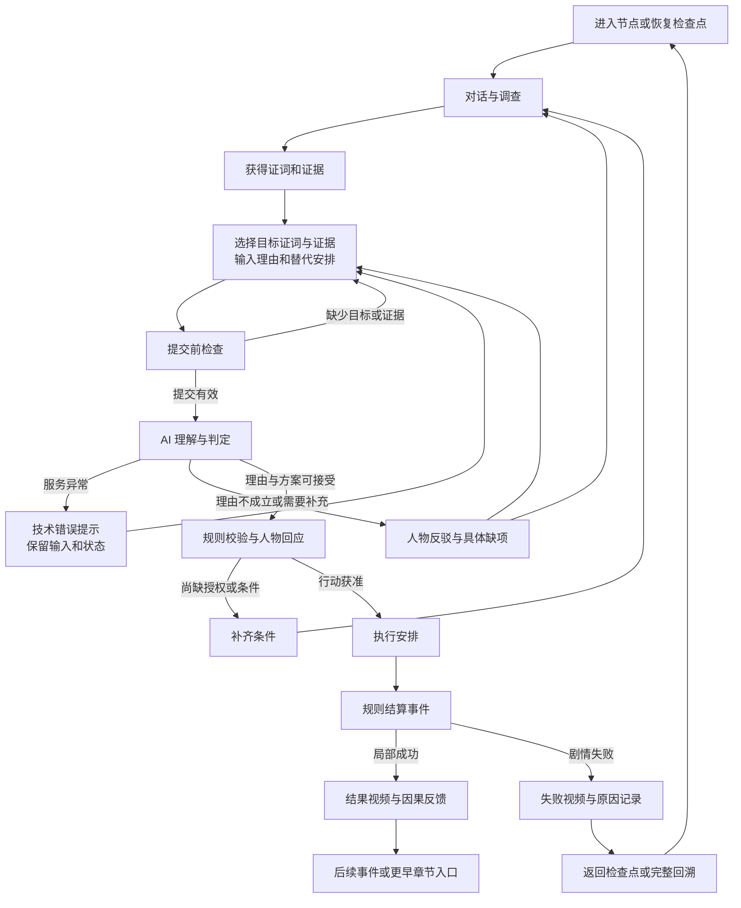

# 时间倒流：互动叙事引擎核心架构与流程 v0.1

本文定义玩法和引擎职责，供剧情编写与后续开发讨论使用。本轮仅编写文档，不开发。数值、角色身份和具体台词属于提案，尚未定稿。

## 1. 核心体验与范围

玩家是一位诸葛亮的粉丝，从电视前穿越到历史故事中，希望让诸葛亮多活几年。玩家通过询问、取证、指出推理漏洞、提出替代安排，改变关键事件；亲眼看到改变的结果后，再追溯更早的原因。

核心操作闭环：

**看故事 → 询问人物 → 收集证据 → 针对证词举证 → 输入理由与安排 → 获得判定反馈 → 执行安排 → 观看结果 → 重试或解锁更早的时间节点。**

策略来自三个问题：人物为何要这样做？哪些证据足以改变他的判断？改变后，原本要解决的事情由谁处理？

教学关卡的目标是让魏延不必闯帐，同时让紧急军情得到处理。失败条件是关键时刻仍发生闯帐灭灯。完成这一夜，代表局部事件被改变；是否真正延寿由后续剧情推进，不能直接等同。

Game Jam 首版建议完整制作五丈原教学关，末尾展示更早章节入口。后续章节复用同一套对话、举证、方案和结果结构。

## 2. 引擎的核心元素

| 元素 | 定义 | 五丈原示例 |
|---|---|---|
| 章节 | 一个可回溯的时间节点，包含目标、事件链和结局 | 五丈原第六夜 |
| 场景节点 | 玩家当前能看、问、检查、操作的范围 | 帐外、前哨、魏延来报 |
| 人物 | 有职责、诉求、所知信息和行动底线的角色 | 魏延必须让军情及时被处理 |
| 证词 | 可逐条询问、质疑的具体陈述 | “必须现在进帐面见丞相” |
| 证据 | 有来源、获取条件和适用范围的信息 | 前哨口述、帐外禁入安排 |
| 道具 | 能参与行动的实物，未必能证明事实 | 用于传报身份确认的木牌 |
| 论证 | 玩家对某条证词提出的理由，并引用证据 | 急报必须处理，但亲自入帐不是唯一办法 |
| 安排 | 玩家提出的可执行方案，需要对应权限 | 请姜维接报，魏延保持戒备 |
| 世界状态 | 决定事件能否发生的事实和行动进度 | 姜维是否已接报、魏延是否仍在等候 |
| 回溯记录 | 跨循环保留的认知与已见结局 | 上次只拦人，军情无人接手，仍然失败 |

证据需要标注“能证明什么”和“不能证明什么”。前哨发现敌军，不能自动证明敌军只在试探；玩家知道未来，也不等于当地人物获得可信证据。

同一个对象可以兼具道具与证据身份，但分别定义用途。拿到木牌不代表获得调兵权；读过禁入安排也不代表能强制命令魏延。

## 3. 总体架构与职责

| 模块 | 负责什么 | 输出 |
|---|---|---|
| 剧情内容库 | 场景、证词、证据、事件前提、行动、反馈、视频和历史来源 | 当前节点的可用内容 |
| 状态管理器 | 记录发现、持有物、授权、事件进度、章节与检查点 | 唯一的当前游戏状态 |
| 对话与调查系统 | 显示可问话题，处理追问和检查 | 新证词、新证据、节点变化 |
| 举证界面 | 选择被质疑的证词、证据，输入理由与安排 | 一次完整提交 |
| AI 判定层 | 理解表达，检查理由是否受到所选证据支持，提取方案含义 | 结构化判定与解释 |
| 规则与事件系统 | 校验判定，检查权限、资源和执行进度，推进事件 | 可执行行动、成功或失败事件 |
| 表现与反馈系统 | 展示人物回应、缺项提示、动画和预制视频 | 玩家可理解的因果反馈 |
| 存档与回溯系统 | 保存检查点和跨循环笔记，恢复确定的状态 | 重试后的状态 |

**AI 负责理解玩家的说法，规则系统负责改变世界。** AI 返回“可接受”不会直接熄灯、点灯、调兵或宣布胜利。

视频用于呈现已经由规则确定的事件。视频播放完毕只确认表现完成，不重新判定剧情。每个视频都需要对应的文字摘要，方便跳过和重看。

## 4. 对话 → 举证 → 反馈 → 执行的状态关系

### 4.1 对话与调查

普通对话采用预设话题和追问。关键证词可以展开成几条短句，玩家选择其中一条质疑。

调查点获得证据时，同时展示来源与原话。关键证据必须可重读，不依赖玩家记住视频中的一闪而过的信息。

教学关建议三段流程：了解帐外规则与传报途径；获取前哨军情；面对魏延完成举证和传报。开放输入集中在最后的关键交涉。

### 4.2 证据出示

一次提交包含四部分：

1. **目标证词**：我在质疑哪一句话。
2. **所选证据**：我凭什么这样说。
3. **论证文本**：证据如何支持我的结论。
4. **替代安排**：谁做什么，怎样解决对方原本担心的问题。

界面可以合并理由与安排为一个输入框，但判定要分别处理。“你不能进去”可能受到禁入安排支持，却仍没有解决军情接收问题。

### 4.3 AI 判定

每次请求仅提供当前节点所需的背景、人物诉求、目标证词、已选证据、已获授权和允许行动。未来章节答案不进入请求。

判定至少回答：证据是否存在且已获取；引用是否准确；推理是否超出证据；是否回应人物诉求；方案是否能映射到关卡支持的行动。

不按文采评分，不要求玩家输入固定关键词。语义等价的说法应该得到相同判断。情绪表达可以影响回应语气，不能替代证据。

| 判定结果 | 含义 | 下一步 |
|---|---|---|
| 接受 | 论证成立，方案可映射到已有行动 | 进入规则校验与授权回应 |
| 需要补充 | 部分成立，但存在明确缺项 | 提示缺项，允许调查或修改 |
| 驳回 | 证据不支持结论，或方案违反已知约束 | 展示具体反驳，允许重提 |
| 需要澄清 | 玩家提出了引擎无法明确处理的安排 | 询问关键细节或提供可表达的行动选项 |
| 技术异常 | 请求超时、无效返回或服务不可用 | 保留输入，重试；不计剧情失败 |

“创意方案暂未支持”不能被解释成“玩家逻辑错误”。首版将方案限制在几个可组合的行动中，例如请人接报、保持戒备、确认回报、约定等待结束条件。

结构化返回建议包含：判定类型、引用证据编号、已成立理由、缺失条件、拟执行行动编号、人物反馈、提示文本。规则系统检查编号有效性和当前条件，拒绝未知行动及越权状态修改。

### 4.4 结果反馈

反馈分三层，不能混为一个“成功”标签：

- **论证反馈**：你说得是否成立，缺了哪一环。
- **人物反馈**：他是否愿意接受、愿意等多久或等待哪个事件。
- **世界反馈**：安排是否落实，最后发生了什么。

示例：“禁入安排确实存在。但敌情谁来接报？你若能立刻请姜维来，我便在此等候。”这意味着获得有限等待机会，尚未过关。

## 5. 时间、失败与重来的规则

### 5.1 时间如何前进

首版使用事件推进，不使用现实倒计时。阅读、播放可暂停的剧情、写字和等待 AI 返回不消耗剧情时间。

只有明确标注的行动会推进事件，例如离开交涉现场去远处取物、确认继续等待、执行传报。行动前显示可能的代价；AI 驳回本身不自动扣时间。

魏延的等待窗口建议用行动阶段表示：允许玩家完成一次传报链；若玩家明确放弃传报或选择无关耗时行动，窗口结束。具体行动额度留待试玩确定。

### 5.2 四种不同的失败

| 情况 | 谁判定 | 是否结束当前循环 | 如何恢复 |
|---|---|---|---|
| 论证未通过 | AI 判定，经规则校验 | 否 | 保留证据和输入，补证或改写 |
| 方案尚未满足条件 | 规则系统 | 否 | 留在当前流程，补授权或执行条件 |
| 关键事件失败 | 规则系统的明确事件条件 | 是 | 播放失败结果，记录原因，再选择回溯 |
| 技术异常 | 请求处理层 | 否 | 原地重试，不改变世界状态 |

剧情失败必须有可指认的触发条件。例如“军情未被接收，等待窗口已结束，魏延仍认为必须面报”，触发闯帐。不能因为 AI 给了低分就直接播放灭灯。

### 5.3 两种重来

**返回关键检查点**用于快速修正交涉和执行。恢复到交涉开始前的完整状态，包括当时持有物、授权、事件进度和已获取证据。检查点之后的行动结果全部撤回；玩家可以保留自己写过的文本草稿，但需要重新提交。

**完整时间回溯**返回当日傍晚。人物行动、实物、授权和事件进度重置；跨循环笔记保留已经读过的内容、看过的失败和因果发现。笔记里知道木牌存在，不代表这轮已经持有木牌；知道某人说过什么，也不代表这轮已经取得可出示的证据。

已看过的常规调查和对话可提供快速重走入口，实际仍要触发本轮获取条件。教学关优先推荐关键检查点重试，完整回溯供玩家重新调查。

### 5.4 失败后应展示什么

失败反馈包含：发生了什么；哪项行动或条件缺失；本轮已经改变了什么；下一次可尝试的方向。

例如：“你让魏延暂时等候，但未把急报交给姜维。等待结束后，他仍选择进帐。”笔记新增“阻止入帐必须同时解决传报”，不直接给完整标准答案。

成功也要说明因果：“魏延留在帐外；姜维接收军情并安排应对；主灯未因这次闯帐熄灭。”

## 6. 五丈原教学关：完整运行示例

本关采用《三国演义》的祈禳叙事。禁入安排有原著依据；具体取证道具、帐外传报流程、玩家介入和替代方案属于游戏补充。

| 阶段 | 玩家行为 | 新增状态 | 进入下一步的条件 |
|---|---|---|---|
| 傍晚调查 | 询问守卫，了解禁入规则 | 已知禁入安排，取得对应证据 | 完成询问 |
| 建立传报途径 | 与姜维相关人员确认接报方式 | 取得传报凭据或有限授权 | 明确可联系的接报人 |
| 前哨来报 | 询问小兵 | 获取前哨口述 | 了解敌军出现，保留未知项 |
| 魏延来帐 | 追问“为何必须亲自入帐” | 解锁目标证词及其诉求 | 进入举证界面 |
| 关键交涉 | 出示证据并提出安排 | 若通过，魏延暂时等候 | 论证成立且安排可执行 |
| 落实安排 | 启动传报，确认姜维接报 | 军情已接收，应对已安排 | 执行链完成 |
| 结果结算 | 观看事件结果 | 第六夜局部目标完成或失败 | 检查世界条件 |

**可接受输入示例：**

> 前哨只确认敌军出现，还没有证据说明营门已失守。急报必须处理，但帐外已有禁入安排。请将军继续戒备，我用传报凭据请姜维接报；若未能联系到他，我们立刻重新商议，不会让急报无人处理。

通过依据：没有把未知敌情说成确定安全；回应了军情必须处理的诉求；提出了关卡支持的接报人与行动；没有凭空取得指挥权。

**需要补充示例：**“丞相有禁入安排，你在外面等就行。”反馈：“军情紧急，谁来接报？”玩家继续补方案。

**驳回示例：**“我看过电视剧，魏军肯定会退。”反馈：“你所说的未来无法查证，眼前急报仍需处理。”

**通过后仍失败的示例：**玩家获得等待机会，却主动放弃传报。规则检测等待结束且军情无人接收，触发魏延入帐；复盘指出执行缺项。

本关世界成功条件建议为：军情已被有权限的人接收；应对已被安排；魏延未因无人接报而闯帐；主灯在该事件结束时仍亮。各条件来自预设事件规则，不由 AI 临时生成。

## 7. 内容数据与运行记录

每个节点编写时需要填写以下内容，保证换章节时不用改引擎：

- 节点编号、进入条件、人物、场景表现和可调查对象。
- 证词原文、人物诉求、可追问内容。
- 证据编号、获取条件、来源、证明范围和历史属性。
- 允许行动、资源与权限要求、时间推进方式。
- 论证接受条件、可补充项、明确不可成立的推断。
- 行动完成条件、事件成功条件、失败触发条件。
- 反馈文案、结果视频、检查点和后续节点。

运行状态分为“本轮世界”和“跨循环认知”。每次有效操作写入事件记录：从哪个节点提交了什么证据、判定为何、哪个条件变化、哪个事件触发。这样才能解释失败并准确恢复检查点。

AI 请求期间锁定同一次提交；重复点击不能重复推进事件。返回结果只作用于发起时的节点与状态版本；玩家已回溯或离开该节点时，旧结果作废。异常返回保留草稿。

## 8. Game Jam 制作边界与验收

建议首版内容量：一个章节、三个主要调查阶段、一组关键证词、四张以内证据卡、一个开放输入节点、一段执行链、两类剧情失败、一个局部成功结局。视频集中在开场、灭灯失败和保灯结果，普通调查使用立绘与文本。

AI 只接入关键交涉；提供预设论证选项作为服务不可用时的备用路径。备用路径使用同一套行动与世界规则，并向玩家说明正在使用预设交涉选项。

后续验收需要实际验证以下路径，本轮文档不代表这些功能已经实现：

1. 不同措辞的有效论证能进入同一执行流程。
2. 未获取证据、夸大证据、虚构权限无法直接通过。
3. 只说服魏延而不完成传报，不能获得世界成功。
4. AI 驳回和网络超时不会自动造成灭灯或消耗等待窗口。
5. 检查点重试恢复一致状态，完整回溯清除实物与授权。
6. 跳过视频、重复提交、回溯后收到旧请求，都不会重复结算。

## 9. 历史边界与待讨论项

《三国演义》第103回写到祈禳已至第六夜，魏延因魏兵到来急入帐中，扑灭主灯；第104回诸葛亮制止姜维责杀魏延，并安排魏延迎敌。游戏不应把魏延写成蓄意害人，也不应把灭灯表现成诸葛亮当场死亡。

正史与演义分开标注。祈禳灯叙事属于演义世界；《三国志》诸葛亮传记载五丈原病逝，不能把新增道具与传报细节当作史书记载。

来源：[《三国演义》第103回](https://zh.wikisource.org/zh-hans/三國演義/第103回)、[第104回](https://zh.wikisource.org/zh-hans/三國演義/第104回)、[《三国志》卷35](https://zh.wikisource.org/wiki/三國志/卷35)。

以下三项留待剧情讨论，当前架构可支持不同选择：

- 玩家具体身份与接近姜维的理由。建议具备有限传报职责，避免默认拥有调兵权。
- 魏延等待窗口具体允许哪些行动。建议事件制，明确显示结束条件。
- 保住第六夜后怎样进入更早章节。必须解释为何还能回溯；七日祈禳尚未完成，不能宣称已完成原著所说的延寿条件却毫无效果。可通过后续因果线索引导更早回溯，具体剧情另行确定。
